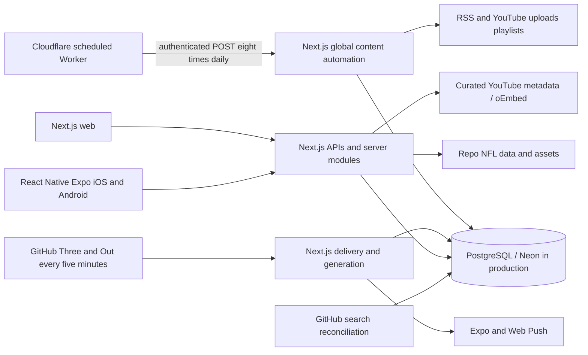

# Down & Distance: production architecture audit

Audit date: October 16, 2026 (America/Chicago). Planning only. Companion documents: [target](TARGET_ARCHITECTURE.md), [database migration](DATABASE_MIGRATION_PLAN.md), [content engine](CONTENT_ENGINE_PLAN.md), [cost analysis](FREE_TIER_COST_ANALYSIS.md), [roadmap](IMPLEMENTATION_ROADMAP.md).

## Decision

Use a staged, measured separation of public editorial content from account and transactional workloads. First establish a baseline and fix content scheduling fairness; add public caching; then qualify a single D1 content database and a small Worker engine. Do not authorize migration solely from the advertised D1 storage allowance. A commercial, fully functional $0 launch is **not yet demonstrated**: hosting eligibility, Workers CPU, production quota recovery, delivery polling and retained PostgreSQL workloads are unresolved gates.

This audit changed only the six requested planning documents. No application code, migrations, database rows, provider settings, bindings, schedules or infrastructure were changed. Earlier Chiefs ingestion in this conversation predates this audit and is not an audit action.

## Evidence and scope

Repository baseline: HEAD `c1b06d36`, with substantial pre-existing uncommitted work. Findings describe the working tree, not a claim about deployed code. Inspected repository structure, all 52 migration files through schema/index/reference inventory, server/API modules, shared feature logic, source registries, mobile API consumers, seven workflow definitions, the scheduler Worker, environment variable names, cache implementations, and existing deployment/cost reports. Large static datasets and media were inventoried rather than read byte-for-byte; this is architecture inspection, not exhaustive functional or security testing.

Evidence labels used throughout:

| Label               | Meaning                                                                            |
| ------------------- | ---------------------------------------------------------------------------------- |
| Current code        | Directly inspected working-tree implementation/configuration                       |
| Current measurement | Read-only aggregate/catalog query or offline registry evaluation during this audit |
| Historical evidence | Earlier repository report; not re-certified today                                  |
| Estimate/proposal   | Explicit planning assumption or future implementation                              |
| Unverified          | Requires deployment/account telemetry or a later benchmark                         |

Current database checks used one connection, `BEGIN READ ONLY`, an eight-second statement timeout and aggregate/catalog queries. No user records, story bodies or credentials were exported. Local PostgreSQL returned `transaction_read_only=on`. The configured production endpoint returned PostgreSQL `53000` (quota exceeded). Production schema, current storage, execution counts and extension availability therefore remain unverified. No repeated production retries were made. Provider account dashboards and live Cloudflare/Vercel bindings were not re-inspected in this audit.

Historical context: [September service audit](docs/service-free-tier-audit.md), [egress audit](reports/neon-egress-audit.md), [environment/scheduler audit](reports/neon-environment-scheduler-audit.md). Their measurements and live checks retain their original dates.

## Current architecture

The Worker is a timer/HTTP forwarder, not the content processor. `workers/content-scheduler/src/index.js` POSTs `/api/automation/content/global`; that route performs registry synchronization, scheduling, job draining, story generation and changed-team Three & Out regeneration inside Next.js. It has `maxDuration=60`. Content and user data largely share `authDb()` and `DATABASE_URL`; search creates a separate client against the same URL.

## PostgreSQL schema and ownership

The migrations are the schema intent. Local catalog inspection returned 253 indexes and 122 foreign keys, with only `plpgsql` installed; `search_documents` was absent locally. Local schema does not prove production migration state. Migration 017 requests `vector`, GIN lexical search and HNSW indexing. Do not assume those features exist on every environment.

| Domain and migration families                      | Principal tables                                                                                                                                                                                                                                                                                                                                                                                                                | Relationships / access / recommended owner                                                                                                                                                                       |
| -------------------------------------------------- | ------------------------------------------------------------------------------------------------------------------------------------------------------------------------------------------------------------------------------------------------------------------------------------------------------------------------------------------------------------------------------------------------------------------------------- | ---------------------------------------------------------------------------------------------------------------------------------------------------------------------------------------------------------------- |
| Identity: 001–005                                  | `users`, `user_identities`, `user_credentials`, `devices`, `sessions`, `auth_tokens`, `user_profiles`, `user_preferences`, `email_change_requests`, `security_audit_events`                                                                                                                                                                                                                                                     | User FKs, session/token expiry and revocation. PostgreSQL. Preserve existing custom auth.                                                                                                                        |
| Preferences/content state: 002–004, 006, 008       | `user_team_follows`, `user_player_follows`, `user_content_state`, `user_team_visit_state`, `user_saved_content`, `user_predictions`, `user_poll_votes`                                                                                                                                                                                                                                                                          | User-owned rows; content identifiers mostly logical references. PostgreSQL; preserve IDs across content move. Later migrations recreate player follows after removal.                                            |
| Notifications: 003, 015, 020, 046–047              | `user_devices`, `user_push_tokens`, `user_notification_preferences`, `user_phone_numbers`, `user_consents`, `user_quiet_hours`, `user_notifications`, `notification_deliveries`, `notification_events`, `web_push_test_limits`                                                                                                                                                                                                  | Consent, audience selection, dedupe, timing and delivery claims. PostgreSQL.                                                                                                                                     |
| Editorial: 012–014, 018–019, 027–028, 034, 043–044 | `content_sources`, `content_candidates`, `ingestion_jobs`, `canonical_stories`, `story_evidence`, `story_versions`, `story_domain_events`, `story_publication_decisions`, `story_editorial_overrides`, `observer_runs`, `observer_run_items`, `observer_run_events`, `content_automation_trial_runs`, `content_automation_runs`                                                                                                 | Sources → candidates → evidence → canonical stories → versions/events/decisions. Proposed D1 ownership. Preserve later semantic/transaction metadata columns.                                                    |
| Three & Out: 013, 033, 047                         | `three_and_out_snapshots`, `three_and_out_push_deliveries`                                                                                                                                                                                                                                                                                                                                                                      | Published payloads → D1; recipient records → PostgreSQL. Existing deliveries have a real FK to snapshots, so the split requires a publication-reference bridge.                                                  |
| Video: 030, 034                                    | `video_source_registry`, YouTube rows in `content_sources` and `content_candidates`                                                                                                                                                                                                                                                                                                                                             | There is no independent discovered-video table today. Proposed D1 sources/candidates plus normalized video metadata.                                                                                             |
| Front Office: 031–032                              | `user_front_office_saves`, `front_office_events`, `front_office_trade_offers`                                                                                                                                                                                                                                                                                                                                                   | Composite ownership/save FKs; version-checked simulation save and events in a transaction. PostgreSQL. Runtime Maps are caches, not substitutes for persistence.                                                 |
| Parlay: 035, 038–040, 050–052                      | `sportsbook_events`, `provider_team_mappings`, `provider_player_mappings`, `bet_markets`, `sportsbook_prices`, `sportsbook_price_snapshots`, `parlay_role_observations`, `parlay_role_feed_runs`, `fanduel_transfer_jobs`                                                                                                                                                                                                       | Events → markets → current/history prices. Transfer ownership, advisory locks, durable idempotency. PostgreSQL. 052 expands the existing transfer table rather than introducing a separate sportsbook job table. |
| Reference stats/schedule: 036–037, 042             | `historical_games`, `historical_player_games`, `historical_team_games`, `historical_team_season_strength`                                                                                                                                                                                                                                                                                                                       | Shared game IDs; canonical story `game_id` is a PostgreSQL FK. Keep authoritative stats/schedule in PostgreSQL; publish a small read-only schedule projection to content engine.                                 |
| Trivia/rewards: 007–009, 011, 045                  | `trivia_questions`, `trivia_daily_questions`, `trivia_daily_views`, `trivia_games`, `trivia_game_questions`, `trivia_game_participants`, `trivia_answers`, `trivia_friendships`, `trivia_challenges`, `trivia_groups`, `trivia_invitations`, `trivia_stats`, `trivia_rank_snapshots`, `trivia_events`, `trivia_event_registrations`, `move_the_chains_accounts`, `move_the_chains_events`, `reward_definitions`, `user_rewards` | Atomic answers, scoring/ranks, participation and rewards. PostgreSQL.                                                                                                                                            |
| Social: 016, 021–022, 029, 041, 048–049            | `game_day_*`, `crews`, `crew_members`, `crew_invites`, `crew_activity`, `crew_reactions`, `crew_shares`, `crew_share_recipients`, `crew_media`, `crew_comments`, `fan_pulse_reactions`, `huddle_*`                                                                                                                                                                                                                              | Membership/visibility/moderation and user FKs. PostgreSQL; private media is outside public editorial storage.                                                                                                    |
| Commerce: 023–026                                  | `commerce_products`, `commerce_product_variants`, `commerce_promo_codes`, `commerce_orders`, `commerce_order_items`, `commerce_inventory_adjustments`, `commerce_stripe_webhook_events`, `commerce_refunds`                                                                                                                                                                                                                     | Inventory/payment/webhook/refund transactions. PostgreSQL.                                                                                                                                                       |
| Search: 017                                        | `search_documents`                                                                                                                                                                                                                                                                                                                                                                                                              | PostgreSQL tsvector and vector search. Retain as a derived index, populated incrementally from the content owner; do not silently drop article or semantic search.                                               |

Primary implementation evidence: `src/server/auth/database.ts`, each domain's `repository.ts`, `src/server/story-engine/repository.ts`, `src/server/three-and-out/daily-service.ts`, `src/server/providers/unabated/transfer-service.ts`, `src/server/search/{database,indexer,retrieval}.ts`.

### Indexes and query behavior

Existing content indexes cover enabled/next-check/priority sources; status/availability/creation job claims; candidate fingerprint, source/discovery and unique source/external-ID and source/URL; story team/update, status, importance and update; evidence story/time and candidate; unique story/version and event idempotency; active editorial overrides; unique published team/date editions. Schedule has season/week, team, kickoff/status and provider identity indexes. These are useful starting points, not a guarantee of optimal plans.

High-frequency code paths:

| Path                                                       | Current behavior and risk                                                                                                                                                                             |
| ---------------------------------------------------------- | ----------------------------------------------------------------------------------------------------------------------------------------------------------------------------------------------------- |
| `processCandidate` → `recentStories` / `evidenceForStory`  | Reads eligible same-team/global recent clusters per candidate, then evidence bodies for matched stories; repeated across articles. Strong egress candidate, not measured attribution.                 |
| `syncAllMonitoringRegistries` / `syncVerifiedVideoSources` | Upserts registry definitions each global run, even when unchanged. Avoidable writes and round trips.                                                                                                  |
| `listPublicStoryPage`                                      | Count + story page + evidence lookups; substring search and correlated source/time expressions. Team/time indexes do not eliminate every scan.                                                        |
| Beat `enrichGameStories`                                   | Feed/detail GETs can persist game resolution by default. Read API is not entirely side-effect-free; must move enrichment to ingestion before edge caching.                                            |
| Film Room `discovered.ts`                                  | Full discovered team catalog; description fallback includes raw text; 60-second Next data cache. Full-response contract must survive migration.                                                       |
| Three & Out delivery                                       | Every-five-minute trigger reads schema/subscriber/edition/delivery state; still wakes Neon when no new public content exists.                                                                         |
| `search/indexer.ts`                                        | Loads published stories and linked article bodies before hashing unchanged chunks. Historical September scheduled executions failed for missing DB configuration; current live executions unverified. |
| Historical/odds research                                   | Large player/opponent histories and event market projections; current 60-second bounded process caches reduce warm repeated reads but do not span instances.                                          |
| Auth, notifications, social polling                        | User-specific DB reads remain; cannot publicly cache session checks or private responses.                                                                                                             |

Additional transactions that must be deliberately redesigned for D1: `FOR UPDATE SKIP LOCKED` job claims; story/evidence/version/event writes; story publication currently creates user notifications inside the same PostgreSQL transaction. Cross-store delivery cannot retain that transaction; use an outbox and idempotent PostgreSQL consumer.

### Storage measurements

Current local database: **528,515,875 bytes (528.5 MB / approximately 504 MiB)**. This is PostgreSQL database size, not Neon project billing size or a D1 export estimate. Local statistics had many zero estimated row counts despite substantial relation sizes; they are not representative workload counts and were not used to extrapolate traffic.

| Local relation including indexes |       Bytes | Approximate decimal MB |
| -------------------------------- | ----------: | ---------------------: |
| `bet_markets`                    | 350,298,112 |                  350.3 |
| `sportsbook_prices`              |  92,594,176 |                   92.6 |
| `sportsbook_price_snapshots`     |  38,100,992 |                   38.1 |
| `historical_player_games`        |  18,071,552 |                   18.1 |
| `front_office_events`            |   3,342,336 |                    3.3 |
| `parlay_role_observations`       |   2,039,808 |                    2.0 |
| `content_candidates`             |   1,908,736 |                    1.9 |
| `content_sources`                |   1,089,536 |                    1.1 |

The three odds relations alone occupy approximately **481 MB locally**. Moving editorial content will not solve unlimited odds/history growth. No retention/delete was performed. Historical production evidence on September 17 measured 151,838,720 bytes, with markets/prices dominant; that figure is **not today's production size**. The September 27 report recorded 6.46 GB transfer over roughly 23 days, about 281 MB/day; extrapolating that old rate gives 8.43 GB/30 days, not a current forecast.

Potential egress includes ingestion clustering/evidence, public API reads, full-corpus search reconciliation if operational, research data, briefing delivery, old deployments and explicit production-to-local scripts. HTTP response bytes and PostgreSQL storage bytes do not directly measure PostgreSQL wire transfer. No current `pg_stat_statements` or provider network/compute measurements were available.

## Content coverage and freshness

Offline registry evaluation with no optional provider credentials loaded confirmed **32 teams**, **120 distinct monitoring definitions**, including **97 credential-free RSS definitions**, 13 unavailable X definitions, five gated web pages, four gated monitoring YouTube definitions and one Reddit definition. Separately `VERIFIED_VIDEO_SOURCES` contains **66 source definitions covering all 32 teams**. Definitions are not proof of reachable sources, active production rows or current uploads. Registry YouTube/WebSub definitions and verified playlist ingestion are separate paths.

Sources include official team RSS, SB Nation and FanSided team feeds, KC-specific publications, national reporters and multi-team sources. `getAllMonitoringSources()` deduplicates source IDs; downstream team association uses normalized entities and team aliases. The actual registry enables live RSS through `observer.ts`; the existence of gated X/Reddit/HTML definitions is not evidence those adapters run.

Flow: conditional RSS fetch (ETag/Last-Modified), normalization, candidate source/external-ID and source/URL deduplication, fingerprinting and clustering, meaningful-change assessment, grounded synthesis, publishing policy, evidence/version/event writes and downstream ranking. Video playlist items remain in Film Room and are excluded from Beat story generation.

Important limitations:

- `SOURCE_BATCH_SIZE` defaults to **10**. Eight global triggers enqueue at most **80 source-fetch jobs/day** before manual/other callers. Current eligible definitions can include 97 RSS plus 66 videos. Fairness and multiple daily checks for every team are not established. Source ordering prioritizes priority before due time and can starve lower-priority sources.
- Draining defaults to 50 jobs/global request and ten generated changes/run, 320/day; actual eight-run generation ceiling is at most 80 changes/day before other callers. A source job can insert many items. There is no end-to-end per-team freshness guarantee.
- Source intervals of minutes do not override an every-two-hour scheduler. Verified video poll interval is six hours. Retries use exponential delays; claimed `RUNNING` jobs have no clear lease-expiry recovery in the inspected claim path.
- Non-material corroboration currently invokes synthesis before preserving canonical wording; it need not invoke a future paid model.
- Deterministic synthesis contains Chiefs-specific wording in `neutralHeadline`; all-team editorial correctness needs regression fixtures before expanding automation.
- Three & Out can be force-regenerated by ingestion and generated on demand during delivery. IANA delivery preferences differ from the scheduler's fixed CST.
- Editorial overrides and aggregate poll reads have process-local Maps in `src/features/three-and-out`; vote POSTs also persist through `user/content-repository.ts`, while validating against the legacy package. These paths are not one unified durable poll service. The SQL override table is a separate implementation. Durable migration must reconcile action formats and data sources rather than assume one store.
- Legacy `TeamContentEngine` defaults include `MockContentSourceAdapter`; `CanonicalEventAdapter` reads a source-engine service with KC seed items. `/api/content/huddle/[briefingId]` calls this engine, and generated JSON briefings are another detail fallback. These are distinct from the live canonical story pipeline and are launch-correctness risks. Preserve existing real-content IDs/deep links while isolating sample sources to previews in a separately implemented change; do not silently import fixtures as production evidence.
- Optional OpenAI topic synthesis is not necessarily manual-only: the legacy content engine can invoke it from a detail GET when configured. Its configuration/cache-miss path must be included in paid-call controls.

## API and mobile dependencies

| Surface         | Existing adapter / coupling                                                                                                                                                                                                                                                                                      |
| --------------- | ---------------------------------------------------------------------------------------------------------------------------------------------------------------------------------------------------------------------------------------------------------------------------------------------------------------- |
| Beat            | `/api/content/huddle`, `/api/content/huddle/[briefingId]`, `/api/content/wire`, `story-engine/projections.ts`, `content/content-detail.ts`, `/content/[id]`; preserve pagination/filter/search/source metadata and detail deep links. Legacy detail uses `teamContentEngine` as well as canonical content paths. |
| Film Room       | `/api/film-room`, `film-room/{discovered,youtube}.ts`, `src/config/film-room.ts`; discovered + curated union, duplicate removal, availability messages and configured flag.                                                                                                                                      |
| Three & Out     | `/api/three-and-out`, preferences/vote/editorial routes and `/api/automation/three-and-out`; published edition/archive is public, preferences/votes/delivery are distinct.                                                                                                                                       |
| Home and ticker | `/api/content/homepage`, `/api/content/next-game`, `canonical-surfaces.ts`; `/api/news` has an in-memory source, so its six-second polling is not automatically Neon egress.                                                                                                                                     |
| Native          | `apps/mobile/lib/api.ts` consumes the same content/homepage/Film Room/Three & Out paths and Beat detail; `/api/mobile/stories/[id]` is another adapter. `apps/mobile/lib/network.ts` owns origin/auth behavior. No database credentials belong in mobile.                                                        |
| Other consumers | Search indexing/results, notification fanout, saved content, fan-pulse/crew shares, schedule enrichment and Front Office content-driven heroes/news. IDs and attribution must remain resolvable.                                                                                                                 |

No web/native screen or API contract was changed. No web, Android or iOS build or visual check was run for this documentation-only task. Native stays React Native; future validation must include actual iOS/Android devices or simulators, not only React Native Web.

## Cloudflare and deployment inventory

Current checked-in Worker: `dnd-content-scheduler`, `src/index.js`, compatibility date `2026-09-07`, `keep_vars=true`, observability enabled. Bindings expected in code: `DND_AUTOMATION_BASE_URL`, `DND_AUTOMATION_SECRET`. No checked-in D1, Queue, R2, KV, Hyperdrive or Durable Object binding; no Worker content API/cache implementation. Asset delivery mainly uses repo assets and external URLs, not demonstrated R2.

Cron `0 0,2,12,14,16,18,20,22 * * *`: eight runs/day, 06:00–20:00 fixed CST (UTC−6); during Chicago daylight time that is 07:00–21:00. September's report records a successful trigger deployment, but today's live schedule was not reverified.

GitHub: content ingestion and standard/video trials are manual. Three & Out uses `*/5 * * * *` (288 triggers/day, up to 8,640/30 days before retries). Search `30 4 * * *`; NFL data `0 3 * * *`; draft `15 8 * * *`. Checked-in schedules do not prove enabled live jobs. Worker README describes Wrangler deployment; no D1/Queue/R2 migration deployment workflow exists. No production configuration was changed here.

Existing Next data/process caches are not a Cloudflare CDN cache strategy. The September environment report found Production/Preview sharing a database integration binding and old retained deployments; verify isolation again before shadow testing. This audit did not publish a diagnostic endpoint or rotate secrets.

## Required measurements before implementation

Recover production quota without a paid upgrade assumption. Obtain effective plans, current Neon project storage/transfer/CU-hours and reset periods; actual all-team source/job counts, oldest pending age and per-team successful checks; Cloudflare requests/CPU and account usage; Vercel plan/eligibility/CPU/memory/transfer; YouTube project quotas; odds/Unabated contract usage. Collect query calls/rows with reset timestamps and bounded server-side size aggregates, never a full corpus download for diagnosis. A later export is a migration action with its own egress budget.

The cost document provides scenarios and explicit stop gates. Nothing in this audit certifies unlimited free traffic or guarantees a paid-plan service will not bill.

## Migration inventory appendix

All checked-in migration files were included in the schema inventory. Counts below are textual declarations (including conditional/repeated declarations), not a claim that every migration is applied in production. Full column/constraint definitions remain in the linked source files.

| Migration                                                                                        | Declared new tables                                                                                                                                                                                                                                                   | Index declarations |
| ------------------------------------------------------------------------------------------------ | --------------------------------------------------------------------------------------------------------------------------------------------------------------------------------------------------------------------------------------------------------------------- | -----------------: |
| [001_auth_identity.sql](db/migrations/001_auth_identity.sql)                                     | `users`, `user_identities`, `user_credentials`, `devices`, `sessions`, `auth_tokens`, `user_preferences`                                                                                                                                                              |                  5 |
| [002_user_profiles_and_preferences.sql](db/migrations/002_user_profiles_and_preferences.sql)     | `user_profiles`, `user_team_follows`, `user_player_follows`, `email_change_requests`                                                                                                                                                                                  |                  4 |
| [003_notifications_and_devices.sql](db/migrations/003_notifications_and_devices.sql)             | `user_devices`, `user_push_tokens`, `user_notification_preferences`, `user_phone_numbers`, `user_consents`, `user_quiet_hours`, `user_notifications`, `notification_deliveries`, `notification_events`                                                                |                  5 |
| [004_user_content_state.sql](db/migrations/004_user_content_state.sql)                           | `user_content_state`, `user_team_visit_state`, `user_saved_content`, `user_predictions`, `user_poll_votes`                                                                                                                                                            |                  2 |
| [005_security_audit.sql](db/migrations/005_security_audit.sql)                                   | `security_audit_events`                                                                                                                                                                                                                                               |                  2 |
| [006_remove_player_follows.sql](db/migrations/006_remove_player_follows.sql)                     | Alter/backfill existing schema                                                                                                                                                                                                                                        |                  0 |
| [007_trivia.sql](db/migrations/007_trivia.sql)                                                   | `move_the_chains_accounts`, `move_the_chains_events`, `trivia_questions`, `trivia_daily_questions`, `trivia_games`, `trivia_game_questions`, `trivia_game_participants`, `trivia_answers`, `trivia_friendships`, `trivia_challenges`, `trivia_groups`, `trivia_stats` |                  4 |
| [008_trivia_gameplay_hardening.sql](db/migrations/008_trivia_gameplay_hardening.sql)             | `trivia_daily_views`, `user_player_follows`                                                                                                                                                                                                                           |                  6 |
| [009_trivia_buddies.sql](db/migrations/009_trivia_buddies.sql)                                   | `trivia_invitations`, `trivia_rank_snapshots`                                                                                                                                                                                                                         |                  2 |
| [010_get_caught_up.sql](db/migrations/010_get_caught_up.sql)                                     | Alter/backfill existing schema                                                                                                                                                                                                                                        |                  0 |
| [011_move_the_chains_rewards.sql](db/migrations/011_move_the_chains_rewards.sql)                 | `reward_definitions`, `user_rewards`                                                                                                                                                                                                                                  |                  1 |
| [012_source_watcher_story_engine.sql](db/migrations/012_source_watcher_story_engine.sql)         | `content_sources`, `ingestion_jobs`, `content_candidates`, `canonical_stories`, `story_evidence`, `story_versions`, `story_domain_events`                                                                                                                             |                 13 |
| [013_story_downstream_projections.sql](db/migrations/013_story_downstream_projections.sql)       | `three_and_out_snapshots`, `story_editorial_overrides`                                                                                                                                                                                                                |                  2 |
| [014_story_automation_policy.sql](db/migrations/014_story_automation_policy.sql)                 | `story_publication_decisions`                                                                                                                                                                                                                                         |                  1 |
| [015_expo_push_delivery.sql](db/migrations/015_expo_push_delivery.sql)                           | Alter/backfill existing schema                                                                                                                                                                                                                                        |                  1 |
| [016_game_day.sql](db/migrations/016_game_day.sql)                                               | `game_day_rooms`, `game_day_room_members`, `game_day_activity`, `game_day_reactions`, `game_day_predictions`, `game_day_events`                                                                                                                                       |                  1 |
| [017_search_documents.sql](db/migrations/017_search_documents.sql)                               | `search_documents`                                                                                                                                                                                                                                                    |                  3 |
| [018_monitor_observer.sql](db/migrations/018_monitor_observer.sql)                               | `observer_runs`, `observer_run_items`, `observer_run_events`                                                                                                                                                                                                          |                  3 |
| [019_story_corroboration.sql](db/migrations/019_story_corroboration.sql)                         | Alter/backfill existing schema                                                                                                                                                                                                                                        |                  0 |
| [020_notification_center.sql](db/migrations/020_notification_center.sql)                         | Alter/backfill existing schema                                                                                                                                                                                                                                        |                  3 |
| [021_crews.sql](db/migrations/021_crews.sql)                                                     | `crews`, `crew_members`, `crew_invites`, `crew_activity`, `crew_reactions`                                                                                                                                                                                            |                  5 |
| [022_crew_share_recipients.sql](db/migrations/022_crew_share_recipients.sql)                     | `crew_shares`, `crew_share_recipients`                                                                                                                                                                                                                                |                  3 |
| [023_commerce.sql](db/migrations/023_commerce.sql)                                               | `commerce_products`, `commerce_product_variants`, `commerce_promo_codes`, `commerce_orders`, `commerce_order_items`, `commerce_inventory_adjustments`                                                                                                                 |                  5 |
| [024_stripe_webhooks.sql](db/migrations/024_stripe_webhooks.sql)                                 | `commerce_stripe_webhook_events`                                                                                                                                                                                                                                      |                  1 |
| [025_stripe_checkout_attempts.sql](db/migrations/025_stripe_checkout_attempts.sql)               | Alter/backfill existing schema                                                                                                                                                                                                                                        |                  1 |
| [026_commerce_payment_hardening.sql](db/migrations/026_commerce_payment_hardening.sql)           | `commerce_refunds`                                                                                                                                                                                                                                                    |                  1 |
| [027_content_automation_trial.sql](db/migrations/027_content_automation_trial.sql)               | `content_automation_trial_runs`                                                                                                                                                                                                                                       |                  1 |
| [028_content_automation_global.sql](db/migrations/028_content_automation_global.sql)             | `content_automation_runs`                                                                                                                                                                                                                                             |                  1 |
| [029_fan_pulse.sql](db/migrations/029_fan_pulse.sql)                                             | `fan_pulse_reactions`                                                                                                                                                                                                                                                 |                  2 |
| [030_video_source_registry.sql](db/migrations/030_video_source_registry.sql)                     | `video_source_registry`                                                                                                                                                                                                                                               |                  2 |
| [031_front_office_save_state.sql](db/migrations/031_front_office_save_state.sql)                 | `user_front_office_saves`                                                                                                                                                                                                                                             |                  1 |
| [032_front_office_events.sql](db/migrations/032_front_office_events.sql)                         | `front_office_trade_offers`, `front_office_events`                                                                                                                                                                                                                    |                  3 |
| [033_three_and_out_daily.sql](db/migrations/033_three_and_out_daily.sql)                         | `three_and_out_push_deliveries`                                                                                                                                                                                                                                       |                  1 |
| [034_isolate_video_from_beat.sql](db/migrations/034_isolate_video_from_beat.sql)                 | Alter/backfill existing schema                                                                                                                                                                                                                                        |                  0 |
| [035_parlay_lab_odds.sql](db/migrations/035_parlay_lab_odds.sql)                                 | `sportsbook_events`, `provider_team_mappings`, `provider_player_mappings`, `bet_markets`, `sportsbook_prices`, `sportsbook_price_snapshots`                                                                                                                           |                  3 |
| [036_nflverse_historical_stats.sql](db/migrations/036_nflverse_historical_stats.sql)             | `historical_games`, `historical_player_games`, `historical_team_games`                                                                                                                                                                                                |                  7 |
| [037_historical_team_season_strength.sql](db/migrations/037_historical_team_season_strength.sql) | `historical_team_season_strength`                                                                                                                                                                                                                                     |                  1 |
| [038_expand_parlay_lab_sportsbooks.sql](db/migrations/038_expand_parlay_lab_sportsbooks.sql)     | Alter/backfill existing schema                                                                                                                                                                                                                                        |                  0 |
| [039_parlay_lab_research_first.sql](db/migrations/039_parlay_lab_research_first.sql)             | Alter/backfill existing schema                                                                                                                                                                                                                                        |                  1 |
| [040_fix_passing_rushing_yards.sql](db/migrations/040_fix_passing_rushing_yards.sql)             | Alter/backfill existing schema                                                                                                                                                                                                                                        |                  0 |
| [041_crew_feed_and_photos.sql](db/migrations/041_crew_feed_and_photos.sql)                       | `crew_media`, `crew_comments`                                                                                                                                                                                                                                         |                  2 |
| [042_canonical_schedule.sql](db/migrations/042_canonical_schedule.sql)                           | Alter/backfill existing schema                                                                                                                                                                                                                                        |                  8 |
| [043_beat_transaction_metadata.sql](db/migrations/043_beat_transaction_metadata.sql)             | Alter/backfill existing schema                                                                                                                                                                                                                                        |                  0 |
| [044_beat_visual_classification.sql](db/migrations/044_beat_visual_classification.sql)           | Alter/backfill existing schema                                                                                                                                                                                                                                        |                  0 |
| [045_trivia_scheduled_events.sql](db/migrations/045_trivia_scheduled_events.sql)                 | `trivia_events`, `trivia_event_registrations`                                                                                                                                                                                                                         |                  1 |
| [046_web_push.sql](db/migrations/046_web_push.sql)                                               | `web_push_test_limits`                                                                                                                                                                                                                                                |                  1 |
| [047_three_out_delivery_timing.sql](db/migrations/047_three_out_delivery_timing.sql)             | Alter/backfill existing schema                                                                                                                                                                                                                                        |                  1 |
| [048_huddle.sql](db/migrations/048_huddle.sql)                                                   | `huddle_messages`, `huddle_reactions`, `huddle_user_filters`, `huddle_reports`, `huddle_enforcement`, `huddle_polls`, `huddle_poll_votes`                                                                                                                             |                  7 |
| [049_huddle_gif.sql](db/migrations/049_huddle_gif.sql)                                           | Alter/backfill existing schema                                                                                                                                                                                                                                        |                  0 |
| [050_parlay_role_evidence.sql](db/migrations/050_parlay_role_evidence.sql)                       | `parlay_role_observations`, `parlay_role_feed_runs`                                                                                                                                                                                                                   |                  1 |
| [051_fanduel_transfer_jobs.sql](db/migrations/051_fanduel_transfer_jobs.sql)                     | `fanduel_transfer_jobs`                                                                                                                                                                                                                                               |                  2 |
| [052_sportsbook_transfer_jobs.sql](db/migrations/052_sportsbook_transfer_jobs.sql)               | Alter/backfill existing schema                                                                                                                                                                                                                                        |                  0 |
