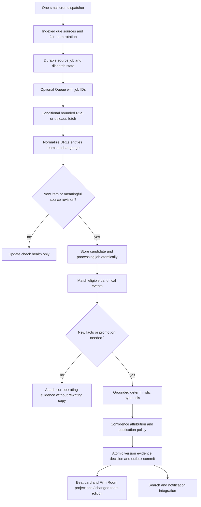

# Down & Distance: content engine plan

October 16, 2026. Proposal; existing schedules and code were not modified. See [audit](ARCHITECTURE_AUDIT.md), [schema](DATABASE_MIGRATION_PLAN.md) and [cost model](FREE_TIER_COST_ANALYSIS.md).

## Launch freshness objective

Discover information for **all 32 teams multiple times daily**, independently of whether a story is generated. Proposed baseline: eight RSS rounds at the current fixed-CST hours and four six-hour video rounds across the full day. Keep the current distinction between fixed CST scheduling and IANA-local delivery timing explicit. The daytime RSS schedule has a ten-hour overnight gap; it is not a promise of two-hour freshness around the clock. Changing to 24-hour discovery is a separate budget/freshness decision.

Current inventory is 97 credential-free RSS definitions plus 66 verified video definitions, not 32 copies of a national feed. Eight RSS rounds and four video rounds imply **1,040 source fetches/day** before failures, pagination and manual work. This is a modeled full-coverage target, far above the current global default maximum of 80 newly scheduled fetch jobs/day. First verify source reachability and deduplicate actual feed URLs/channel IDs; retain all team associations.

Proposed healthy-operation acceptance: every team has a successful relevant RSS check in each completed daytime round, no reachable source is skipped across two rounds, video channels are checked at least four times/day, and ordinary rounds drain within 20 minutes. Provider outages are visible health failures, not invented content. Record `last_attempt`, `last_success`, `last_material_item` separately so quiet teams are not called stale.

## Processing flow

## Scheduling and fairness

Use one cron expression driving a small dispatcher at a qualified interval, initially one minute; due source times retain the proposed RSS/video cadence. A tick performs a bounded indexed due-page claim and enqueues job IDs; it never fetches all 163 sources or parses a full day's feed in one invocation. Claim/dispatch in small batches within Free CPU, subrequest and row budgets. Deduplicate round jobs by `(source_id, scheduled_round)` and update source next-check/dispatch state atomically. Keep one global control cursor rotating teams and tiers, including NFL-wide sources.

National feeds and shared channels are fetched once, then associated with relevant teams. Resolve immutable YouTube channel/uploads IDs during reviewed registry changes, not every polling round. Seed source definitions once and update only a changed definition hash. No unconditional 186-row registry rewrite per run.

Discovery, candidate processing and downstream projections get separate fair shares; the current source-first ordering must not indefinitely delay candidates. A source's failure does not block the next source or team. Reserve processing capacity for late candidates and retries. Exact throughput is benchmarked; `SOURCE_BATCH_SIZE=10` must not become a hidden all-team cap.

If Queue is enabled, use one queue and one consumer initially, with one job/message per qualified small batch. Default messages under 1 KB contain only IDs, type and fencing token. No article bodies, API keys or user data. D1 is the durable job ledger and supports recovery beyond Queue's free retention; Queue delivery is not exactly once. [Queues pricing and retention](https://developers.cloudflare.com/queues/platform/pricing/).

## News fetching and identity

Retain ETag/If-Modified-Since and source timeouts; an unchanged 304 saves parsing but still consumes a fetch. Validate content type, redirect destinations and body size; restrict sources to reviewed URLs and prevent private-address fetches. Stream bounded pages and fail visibly on an unsupported oversized response rather than silently truncate published data. Respect source terms and robots where applicable. Do not enable gated X/Reddit/page adapters merely because a definition exists.

Normalize tracking parameters, canonical URLs and external IDs consistently with existing normalization. Unique source/external-ID and source/canonical-URL prevent exact repeats; preserve independent publishers and evidence. Store source revision hash so a changed injury fact on the same article can be reconsidered without making a duplicate canonical story. The current INSERT/ON-CONFLICT path can ignore such revisions; introduce revision handling behind parity tests rather than assuming it already exists.

Cluster using current entities/type/team/time-window logic, including global stories and ambiguity review. Read indexed candidate clusters with a reusable per-job window; invalidate the window after each commit. An entity index is an optimization, not permission to omit valid old matches. Benchmark against the complete eligible 72-hour reference set. Keep low-confidence or contradictory matches for review.

## Meaningful updates and generation

A new title, ingestion timestamp or fetch is not sufficient to regenerate. Compare normalized evidence/claims and existing material-change logic. New confirmed facts, availability changes, transaction terms, official confirmation, resolution and publishing-policy promotion can create a version. Wording-only updates attach evidence and may update attribution/confidence without changing meaningful publication time. Preserve source IDs, links and independent-publisher distinctions.

Default generation is the existing grounded deterministic synthesizer, which has no remote inference fee. Share platform-independent rules while removing Node-only imports from Worker code. Correct Chiefs-specific fallback wording under separate implementation tests for every team; do not copy those fallbacks into a new all-team engine. No fixture stories in production.

Proposed controls: keep 320/day as a global maximum, add fair per-team reservations and per-run/time-slice limits, and use **80 changed stories/day only as the launch scenario**, not a forced product cap. Reserve generation slots atomically so concurrent jobs cannot exceed the global cap. A budget hold leaves durable pending/review state and a reason; it does not mark unprocessed content as complete. User-requested approved higher load requires remeasurement.

Paid AI remains disabled with an explicit zero-dollar gate. Any later model path must reserve a dollar/token allowance before the request, cache by model/prompt/evidence fingerprint, cap input/output/retries, and record actual usage. No automatic fallback from deterministic or local inference to paid APIs. Ollama on a developer machine is not a production hosted service; ongoing inference requires independently budgeted compute. The existing optional OpenAI topic summarizer is a separate path from the scheduled story engine; legacy detail GETs can reach it on a cache miss. Gate all entry points, not only scheduled/CLI calls, in any future Worker or facade.

## Film Room

Continue uploads-playlist discovery, store per-channel checkpoints and fetch shared channels once. Deduplicate by immutable video ID and associate the video with every relevant team. Use `playlistItems.list` for discovery; batch metadata for new/expired IDs (up to provider limits), cache channel metadata and preserve curated selections. Keep full original metadata and dates, missing/hidden statistics as null, duration formatting, unavailable/private/deleted behavior and team/category filters.

Use provider-returned thumbnails and player embeds under their terms. R2 stores only permitted owned/licensed assets; it is not a YouTube media mirror. Metadata refresh is background work, not a paid transcript/video-analysis service. Existing Film Room discovery does not demonstrate automatic video transcription or model video analysis; adding it would require separate authorization and a cost plan.

Google currently documents one unit for playlist/video/channel list methods; its current quota calculator lists separate search/upload buckets, differing from the older `search.list costs 100` comment in this repository. Verify effective project quotas and use no recurring channel search. The model budgets 264 daily uploads calls plus up to 100 metadata/channel calls and retry headroom, not a claim about live project usage. [Google quota calculator](https://developers.google.com/youtube/data/determine_quota_cost).

## Three & Out and downstream work

Generate only from publishable sourced stories using existing ranking/overrides and time windows. A team/date edition fingerprint includes selected story IDs/versions, editorial override revision and summary schema version. If unchanged, skip. Do not regenerate all 32 editions after each article. Group changed-team edition work at the end of a round, while preserving on-demand publication requirements for delivery windows.

Keep source windows, date selection, prior-edition archive and the requirement for three verified stories. If insufficient verified content exists, preserve existing unavailable behavior; never fill with synthetic news. Edition publication emits a versioned reference event to PostgreSQL, which retains consent, preferences and delivery claims. Poll votes and user state stay private. Preserve once-per-user/day/channel delivery; do not promise exactly-once external push transport after an ambiguous provider timeout.

Notification/search work is driven by versioned outbox events. Payloads contain enough published context to replace current cross-DB canonical-story joins. A consumer does not query raw editorial corpora for each user. Audience fanout and notification preferences remain PostgreSQL operations. Group bridge calls into round/time buckets to reduce Neon wakeups without delaying breaking notifications beyond their existing policy.

## Retries and crash recovery

| Failure                                         | Behavior                                                                                                                                                                       |
| ----------------------------------------------- | ------------------------------------------------------------------------------------------------------------------------------------------------------------------------------ |
| Network timeout / 429 / transient 5xx           | Honor Retry-After; exponential delay plus jitter, source-specific cooldown, up to five attempts; budget reserves checked before retry.                                         |
| Removed feed / invalid auth / malformed payload | Classify permanent vs operator-review failure; quarantine the source/job visibly; no tight retry loop.                                                                         |
| Worker CPU/subrequest limit                     | Split resumable work at validated boundaries; mark step checkpoint only after commit. Qualify against real Free runtime before enabling. Never auto-upgrade.                   |
| Crash after job claim                           | Conditional lease-token claim; reclaim expired lease, increment attempt and fence stale completion.                                                                            |
| Candidate saved, processing message lost        | Save candidate + durable job in the same D1 batch. Reconciler dispatches unsent work.                                                                                          |
| D1 commit succeeds, Queue ack lost              | Duplicate delivery sees idempotency key/status and exits; emits no repeated notification/version.                                                                              |
| PostgreSQL bridge unavailable                   | Retain outbox; retry with jitter and increasing delay; public content may continue within bounded outbox/storage budget.                                                       |
| Free quota near exhaustion                      | Pause optional discovery/generation first, preserve existing public content and user services where possible, expose stale health; do not silently publish incomplete results. |
| Queue expires / poison message                  | Reconstruct from D1 ledger after availability reset; DEAD status and diagnostic reason retained; a separate paid DLQ is unnecessary.                                           |

CAS/lease version tests must include concurrent candidate matches and a story-version conflict that yields zero affected rows; atomic batch execution alone does not detect a logical conflict. Durable job/outbox state must survive transport loss and deployment restarts.

## Observability and acceptance

Record per-team attempted/successful source checks, feed-not-modified rate, unique/revised candidates, merged/rejected/review/published decisions, source latency, oldest pending age, retry/dead counts, version conflicts, edition fingerprints, outbox lag, handler CPU, D1 metered reads/writes and storage trend. Report minimum freshness across 32 teams, not just a global success count.

A seven-day qualification includes all 32 team themes/data, a simulated busy game day, idle day, repeated unchanged feeds, source outages, late official confirmation, corrected/deleted videos, malformed payloads, midnight/DST boundaries, expired leases and queue retention loss. Public route contracts and actual iOS/Android navigation/loading/error/empty behaviors must remain compatible. No such runtime qualification occurred during this planning audit.

Retention proposal, subject to approval: compact completed job/run logs after 14/30 days, keep unacknowledged outbox indefinitely until resolved, and archive older raw evidence only with checksum-backed retrieval. Preserve public stories, edition links and user saved-content references. Retention reduces storage, but deletion/archive operations themselves consume resource budgets. Do not implement deletion during this task.
