# Execution and transaction boundary decision

**Implement native Cloudflare transaction execution; retain Render computation.** The public D1 REST rollback contract remains unverified and is no longer on the active data path. The local candidate passes validation. Hosted CPU, capacity and deployment preflight remain unverified; no deployment or resource creation occurred.

| Required item            | Result                                                                                                                                                                                                                                                                                                                                                                                                        |
| ------------------------ | ------------------------------------------------------------------------------------------------------------------------------------------------------------------------------------------------------------------------------------------------------------------------------------------------------------------------------------------------------------------------------------------------------------- |
| D1 REST atomicity        | **UNVERIFIED for the required compound operations.** Official REST documentation accepts SQL/parameters and batch-shaped requests but does not establish an equivalent rollback contract. Existing remote REST write/batch refusal remains unchanged                                                                                                                                                          |
| Selected architecture    | **A's transaction placement, retaining the existing Node API/SSR computation.** Render performs Firebase verification, API business logic and SSR; a minimal private Cloudflare API Worker executes all reads/writes through native D1 bindings. Existing Web Worker authenticates gateway requests and calls that private API through its existing service binding. No third provider or new Worker/database |
| CPU implications         | The historical 47/40 ms identity-exchange path, framework and Firebase cryptography run on Node, not in either gateway Worker. Worker work is bounded transport verification, nonce claim, parameter decoding, native D1 dispatch and serialization. **Hosted <=10 ms compliance remains UNVERIFIED**, including cold requests and large results                                                              |
| Security                 | **PASS locally.** Distinct server-only origin/transaction credentials and audiences, short-lived body-bound assertions, durable nonce claims, private service binding, fixed logical owners, parameter binding, maintenance denial, no client database command access, no account API token on Node                                                                                                           |
| Transaction integrity    | **PASS for documented native batches and actual local workerd tests.** One application batch is one native `db.batch()` call. Constraint failure rolls back all statements; concurrent CAS has exactly one winner; ownership/fences/idempotency/recovery preserved. No ten-database distributed transaction is claimed                                                                                        |
| Tests passed             | 85 regression tests; final 3 native boundary/security/recovery tests; 78 end-to-end assertions; production Node API/SSR build; TypeScript; formatting; two offline Worker dry runs with existing logical bindings and gated assets                                                                                                                                                                            |
| Tests failed             | None outstanding. Initial typecheck cast and offline legacy-test configuration failures were corrected. Argon rollback coverage explicitly selects offline legacy mode; staging integration/startup continue to require Firebase and disable legacy password endpoints                                                                                                                                        |
| Ready for hosted staging | **Local implementation READY for review; hosted staging NOT YET QUALIFIED.** Separate authorization, account/resource/billing preflight and hosted CPU/memory/quota validation are required before activation. No controlled-beta or production GO                                                                                                                                                            |
| Remaining blockers       | Actual CPU of both gateway Workers; Render Free eligibility, isolated memory/concurrency and cold starts; live Worker/D1 quota headroom and nonce overhead; reviewed secret/binding configuration and private API ingress; conservative shared Node client-IP rate bucket                                                                                                                                     |
| Next action              | Review this boundary and the runbook, then separately authorize a bounded staging-only feasibility deployment after confirming Free/no-billing eligibility and exact existing bindings. Measure both Worker CPU paths and Render memory; stop rather than weaken authentication, split transactions or activate paid services                                                                                 |
| Branch                   | `release/down-distance-firebase-auth`                                                                                                                                                                                                                                                                                                                                                                         |
| Commit                   | Baseline `5f0629db`. Implementation/evidence commit `4e05139f`; `git log -1 --format=%H -- EXECUTION_BOUNDARY_DECISION.md` identifies the completed report commit                                                                                                                                                                                                                                             |

## REST findings and native guarantees

The current [public REST query reference](https://developers.cloudflare.com/api/resources/d1/subresources/database/methods/query/) documents SQL, bound parameters and multiple-query request/results. This is insufficient evidence of all-or-nothing failure semantics under concurrent writers. Successful sequential requests, matching `/query` names, or a working local REST fixture do not establish that contract. No hosted REST probe or remote database operation was authorized or performed.

Cloudflare explicitly documents [native binding batches](https://developers.cloudflare.com/d1/worker-api/d1-database/#batch) as transactions, executed in order, with sequence rollback on statement failure. D1 [serializes work within each database](https://developers.cloudflare.com/d1/platform/limits/). This supports native transactional execution; read/modify/write spread over separate requests still requires the existing conditional predicates and guards. It does not establish a cross-database transaction.

| Required capability                | Public REST conclusion                                                          | Selected native path                                                                                                                                                                     |
| ---------------------------------- | ------------------------------------------------------------------------------- | ---------------------------------------------------------------------------------------------------------------------------------------------------------------------------------------- |
| Conditional writes / CAS           | SQL can express predicates; equivalent compound transaction contract unverified | Conditional UPDATE plus failing `changes()` assertion in one native batch; two concurrent contenders produce exactly one committed winner                                                |
| Multi-statement batch / rollback   | Batch shape documented; required failure contract unverified                    | Single native batch; later duplicate-key failure removes the earlier write too                                                                                                           |
| Concurrent writers                 | No new remote validation                                                        | Actual workerd/D1 tests exercise concurrent CAS and duplicate nonce claims; one succeeds, losing transaction rolls back                                                                  |
| Write fences                       | Cannot qualify compound fence/publish through unverified REST                   | Existing epoch check, guard and publication remain one native batch; stale writer cannot publish                                                                                         |
| Idempotency                        | Not an automatic property of either transport                                   | Existing Front Office command IDs retain same-result replay and conflicting-command rejection; ambiguous transport outcomes are never automatically retried                              |
| Ownership / cross-shard references | Public API does not replace application ownership checks                        | Fixed owner adapters reject mixed-owner batches; existing authenticated repositories retain user ownership and original team/global IDs                                                  |
| Recovery                           | Runtime REST adapter was blocked                                                | Existing owner-only native tools retain coordinated backup, empty-target restore and current independent erasure-ledger replay; runtime gateway cannot perform schema/restore operations |

The original ten databases, schema, routing map and application identifiers are unchanged. Cross-shard saves and erasure retain their existing staged/idempotent coordination. They are not converted into an invented ten-shard atomic commit.

## Why this is the smallest safe boundary

Strict A—moving all 201 application handlers back to Workers and leaving only auth/SSR on Render—would require another application split and would retain substantial framework/repository first-use work on Workers. SSR already needs server-side repository access. Removing only Firebase signature verification would not demonstrate that the distributed historical 40 ms path fits 10 ms.

B—retaining direct public D1 REST transactions—has less transport code but cannot be selected without the missing rollback guarantee. This mission does not enable the old adapter or add a speculative REST override.

The selected adaptation uses A's required transaction placement while retaining the baseline Node API/SSR implementation. The existing Web Worker becomes the authenticated entry to a minimal executor in the existing private API Worker. This changes only the server database transport and opt-in Worker entrypoints. All application SQL execution remains on Cloudflare. There is no new domain API, duplicated business logic, migration, identity-provider change or new hosting provider.

```mermaid
flowchart LR
  Browser -->|existing private staging gate| Web[Existing Web Worker: assets and routing]
  Web -->|origin assertion| Node[Render Node: Firebase verification, API and SSR]
  Node -->|separate signed server capability| Gateway[Same Web Worker: nonce claim]
  Gateway -->|private API_SERVICE binding| API[Existing API Worker: native executor]
  API -->|one native batch per transaction| D1[Existing ten D1 databases]
```

The compiled Web gateway is approximately 10 KB and private API executor approximately 6 KB; [the build input manifest](reports/execution-boundary/worker-build.json) confirms that the executor imports neither Firebase verification nor the application framework. These sizes support the execution-boundary claim, not a CPU compliance claim. The Node API still retains all 201 existing handlers. No existing deployed Worker configuration references these new entrypoints.

## Security and transaction implementation

[Node binding transport](src/server/node-staging/d1-worker.ts) emits only server-generated repository statements and bound parameters to one pinned staging URL. Node holds a dedicated transaction secret, never a Cloudflare account API token or database UUID mapping. Startup rejects `D1_REST_TOKEN`/`CLOUDFLARE_API_TOKEN`; there is no REST fallback. Configuration is snapshotted, owners are fixed, mixed-adapter batches are rejected, bodies/results are bounded, BLOBs use bounded base64, redirects are manual, and ambiguous failures have no automatic retry. No transaction is split to fit transport limits.

[Web gateway](workers/staging/render-origin.ts) reserves `/__staging/transaction`. It requires a distinct 20 second HMAC assertion binding audience, method, canonical URL/path/query, filtered headers, body digest and nonce. It validates and durably claims the nonce before private service dispatch. A genuine staging browser cookie, forged identity/forwarded headers, the edge-to-Render audience, and missing/expired/modified/replayed assertions cannot authorize database execution. The normal staging gate still protects assets, APIs and SSR origin routing.

[Private API executor](workers/staging/transaction-api.ts) rechecks the signed request across the service-binding boundary, validates logical owner and parameter/statement budgets, and performs exactly one native batch. It exposes no normal product/admin route. Schema-changing and restore SQL are rejected; required CTEs and read-only schema inspection remain compatible. Errors do not include SQL parameters, credentials or private provider payloads.

The API Worker **must remain private**: Web is the sole externally reachable ingress and owns replay claiming. The executor's second signature check deliberately does not claim the same nonce twice. Private ingress is a required configuration invariant, not an inference that a raw header is trusted. Web's nonce claim uses 4 native statements in its own invocation; the private API has a separate budget for up to 50 application statements. This avoids consuming a transaction's Free query budget with transport bookkeeping. The [Free per-invocation query limit](https://developers.cloudflare.com/d1/platform/limits/) still applies.

This gateway is privileged server infrastructure, not a client SQL feature. The trusted Node application can access its owned logical bindings, as the prior server could; possession of its private capability must be treated as server-level data access. Browser requests never select the gateway's SQL, owner or capability header. Existing application routes still perform Firebase signature/issuer/audience/expiry/UID verification, fresh provider revocation checks, D1 tombstones, session lookup, user ownership and account-erasure authorization. No successful authorization decision is cached.

## Validation and recovery evidence

- [85 regressions](reports/execution-boundary/regression-tests.log): authentication/forged and expired tokens/revocation, private SSR transport, Front Office normalization, Parlay, prior fail-closed REST/origin tests and native boundary/recovery tests;85 pass, 0 fail.
- [Final native tests](reports/execution-boundary/transaction-tests.log):3 pass, 0 fail in two actual workerd Workers connected by service binding to ten local D1s. Covers rollback, concurrent CAS,50 statement batches, BLOB compatibility, CTE/schema-read compatibility, stale fences, owner mismatch, Worker restart/persistence, no retry, authentic browser-cookie command denial, forged/expired/tampered/replayed assertions, concurrent single-use claim and maintenance denial.
- The same native tests create cross-shard saved articles/bets, preserve original IDs and user isolation, create a coordinated archive, then erase a synthetic user **after** that archive. Restoring only into empty local targets with the newer independent ledger leaves that user deleted. Original saved identities survive and corrupt archive validation prevents mutation.
- [Full compiled Node integration](reports/execution-boundary/integration.json):78 assertions pass through the gated edge, authenticated Node origin and actual workerd native gateway. Genuine synthetic RSA Firebase SDK registration/login, UUID-preserving identity exchange, native bearer session, logout/revocation, cross-user isolation, account-deletion journal, all 32 team/global feeds, Front Office full create/readback/idempotent replay/conflict, saved articles/bets, Parlay synthetic paths, signed-in homepage/Front Office/Parlay/Account and signed-out redirect.
- [Chrome mobile-width Account rendering](reports/execution-boundary/browser-account.png) was inspected visually. This is browser validation, not Android/iOS device validation. No renderer/UI was changed. Invalid/expired token checks and browser/SDK flows are separate tests; not every page/form is visually qualified. Foreign-user deletion proof remains rejected with the existing generic HTTP 500 classification.
- [Production Node API/SSR build](reports/execution-boundary/node-build.log), [Node bundle](reports/execution-boundary/node-api-bundle.json), [typecheck](reports/execution-boundary/typecheck.log), [format](reports/execution-boundary/format-check.log), [Web dry run](reports/execution-boundary/web-dryrun.log), [API dry run](reports/execution-boundary/api-dryrun.log). Existing unrelated build warnings remain. Dry runs validate local bundles/config shape, not live inventory, exposure or quotas.

Recovery remains owner-only through native bindings, outside the runtime gateway. Maintenance locks deliberately block gateway traffic. Stop writers, coordinate all ten databases, retain the current independent erasure ledger, restore only empty isolated targets and verify identities/references/integrity before unlocking. Wait at least 30 seconds after restoring nonce history before reopening traffic; expired assertions must not become replayable after a ledger rollback. No occupied hosted database was restored, deleted or modified.

## Remaining hosted decision

The final bounded synthetic workload made 867 gateway requests and 229 application batches in the private API, plus one native Web nonce-claim batch per gateway request, with one cached synthetic Google public-key fetch and 47 live synthetic provider lookups. These are local counts, not account usage. There is no public D1 administrative REST traffic in this path, so its shared administrative API rate bucket is no longer the application data transport. Each gateway command instead produces Web/API Worker requests and a native nonce transaction with at least 3 logical row mutations plus expiry cleanup; indexes may increase billed writes. Measure real Worker requests, D1 rows/storage and error rates before any daily-user projection.

No actual Cloudflare CPU was measured this mission. Node executes the formerly failing identity-exchange path without a 10 ms request ceiling; Render still has its Free CPU/memory/availability constraints. Both gateway Worker CPU distributions, especially cold requests, larger BLOB/results and nonce cleanup, need bounded hosted measurements. Do not infer Free compliance from bundle size or local wall time. If either Worker exceeds its allowance, stop and report the measured operation; do not weaken hashing/token verification or raise a paid limit.

The integrated test process RSS includes Node/Next/test infrastructure and is not an isolated Render service measurement. It exceeded 512 MB. Render memory/concurrency and startup peaks remain unqualified. The prior [Render feasibility report](RENDER_FREE_STAGING_PROTOTYPE.md) still applies to Free sleep/cold starts and external-database traffic restrictions. Cold wake can exceed the 15 second proxy timeout/20 second assertion: fail closed and require a fresh request, without automatic mutation replay. Node's conservative shared unknown-client IP bucket remains a usability limitation.

**Exact next action:** review the [wiring/security/reproduction runbook](scripts/render-staging/README.md), confirm the owner account can remain Free without billing, verify exact existing staging bindings/private ingress and disabled providers/schedules, then separately authorize a bounded hosted feasibility test. A Render service must not be created implicitly. Measure both Worker CPU paths, isolated Node memory, authentication/revocation/SSR, Front Office/saved content/deletion and live quota overhead before a readiness decision.

Work occurred only in `/private/tmp/down-distance-rc3` on the requested release branch. Main checkout remained untouched. No deployment, resource creation, billing activation, provider activation, database migration, production/domain/Vercel modification, live account/provider test or change to staging exposure occurred. Remote exposure/account plans were not re-verified by this local-only mission.
