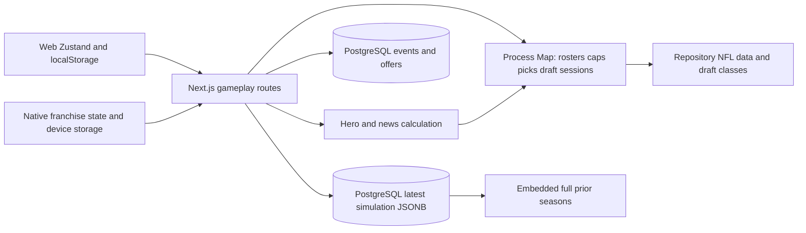
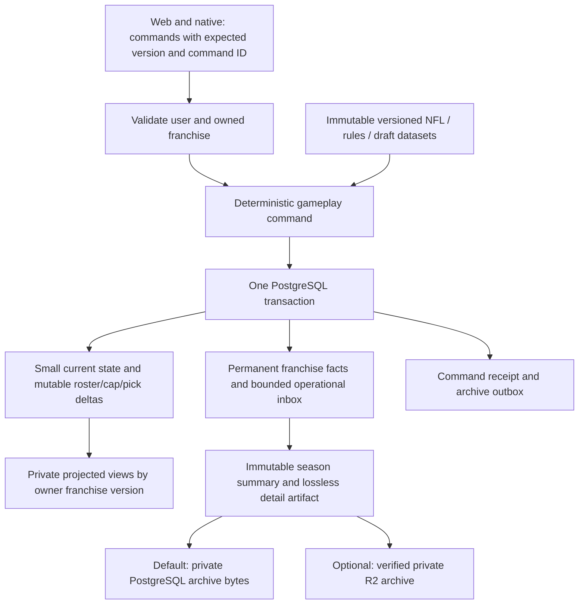

# Front Office scalability, caching and data lifecycle plan

October 16, 2026 · Down & Distance · Audit plus local FO-1 implementation

## FO-1 local implementation — October 16, 2026

The user subsequently authorized local FO-1 implementation and revised the legacy recovery requirement. This section supersedes the earlier planning-only/legacy-recovery stop condition for FO-1. The audit below remains the historical baseline. Production has not been migrated or deployed; no paid service was activated.

### Durable state and security

PostgreSQL now owns a schema-version-1 mutable runtime envelope for each `(user_id, save_id)`. It includes all 32 rosters/caps, contracts and player overrides, free-agent market, picks/ownership, transaction and offseason state, every draft session and RNG/cursor, and trade workspaces. Existing `user_front_office_saves.simulation_state` retains the simulation seed, game results, team progress and histories. Both records and affected events/offers commit in the same transaction.

`withFranchiseRoute` authenticates cookie or bearer sessions, resolves only owned IDs, locks the owned metadata row, verifies checksums/reference hashes, checks the expected version, and runs the legacy business functions in request-local AsyncLocalStorage Maps. Shared process Maps are no longer authoritative in private HTTP handlers. Compatibility aliases join the same workspace and SQL transaction. Failed validation, rejected results, exceptions or SQL failures roll back; the caller receives success only after transaction commit. Private responses use `Cache-Control: private, no-store`.

Every mutation requires `X-Franchise-Command-Id` and `X-Franchise-Version`; the owned save is supplied in the existing payload/query or `X-Franchise-Id`. Creating a new franchise uses expected version 0. A successful command increments the franchise version once and stores its request hash and gzip response receipt atomically. Exact retries replay the stored result; changed inputs with the same ID and stale versions return 409. Missing metadata returns 428. Web and native transports retain command identity after ambiguous network/5xx failures; they do not silently retry a changed action. Versions are learned from server headers and cleared on actor changes.

Identical immutable initial entity bundles are content-addressed and shared. Mutable player/pick objects store reference IDs plus overrides and removed fields; private recovered data never becomes shared base data. Changing rules still require a state schema migration; this is not arbitrary cross-version compatibility. The owned roster alias is reattached after JSON decoding. Explicit season rollover preserves traded future picks, issues new horizon picks, retains draft history, updates all teams' contracts and market, and preserves the full first year of incoming rookie contracts. Real draft completion commits CPU selections as well as user selections. Durable reads do not implicitly perform legacy season rollover.

### Storage inventory and reconciliation

- Durable legacy sources: save metadata/simulation JSON, events and persisted offers. Migration copies the entire original save row into `legacy_record` without updating the original.
- Process sources: `__frontOfficeSaveStore` and `__frontOfficeTradeStore`; the old team index has no trustworthy owner dimension. An authenticated owner can explicitly inspect an available server candidate only when that save ID has exactly one database owner. An ambiguous ID is never imported. Old Maps are retained rather than cleared, but cannot survive a process that already lost its memory.
- Web sources: `nfl-manager-save`, active save/draft snapshots, per-save path and experience preferences. On account changes, recoverable save bytes are backed up under `nfl-manager-save-recovery:<owner-or-unverified>:<saveId>`. Unknown ownership is evidence, never authorization. Storage failures preserve original bytes and clear the visible private view. Team selection backs up the prior local record before replacing its visible cache.
- Native sources: owner/team-scoped device franchise ID, cached roster/draft session snapshots and large-device draft data. Partial client DTOs do not establish complete CPU rosters, contracts, market or pick history and are never silently restored as authoritative data.

Statuses are `LEGACY_PARTIAL`, `RECONCILIATION_REQUIRED`, `LEGACY_COMPLETE`, `MIGRATED`, and reserved `MIGRATION_FAILED`. Existing saves start partial. Structural completeness means a candidate has all required mutable domains, all 32 teams/caps, consistent owned roster copies, valid player/contract fields, the full four-season pick-rights inventory, draft continuation, and usable simulation seed/team/game/playoff progress. It cannot establish historical truth that was never persisted. Missing simulation or mismatched runtime/simulation seasons blocks confirmation. A failed migration rolls back to its previous status; it is not falsely marked migrated or forcibly changed to MIGRATION_FAILED.

`GET /api/front-office/recovery?saveId=…` gives an owned report. A versioned POST with `action: "inspect"`, `runtime`, `simulation` when needed, and `tradeWorkspaces` stages a candidate; `useServerCandidate: true` explicitly captures available unambiguous process evidence. Each submitted artifact/report is retained in `front_office_recovery_evidence`; superseding a candidate never deletes earlier evidence. Inspect can store incomplete data. Confirmation requires a complete candidate, explicit trade-workspace inventory (including an explicit empty array), `confirm: true`, and exact attestation `I confirm this is my complete recovered franchise state`. The original legacy row remains preserved. No reference initialization is substituted for recovered progress.

Web and React Native show a recovery-required state, report access, and an explicit separate-franchise choice. Native restoration uses the stored owned franchise ID rather than selecting a different latest save for the same team. A separate save gets a fresh ID and keeps the legacy save. Reconciliation is currently a controlled API workflow; neither client claims its partial cache can automatically recover a complete franchise. No automatic migration is allowed just because simulation JSON exists.

### Migration and changed files

Implemented additive migration: `db/migrations/053_front_office_durable_commands.sql`. Tables: reference bundles, durable state, command receipts, append-only recovery evidence; indexes for receipts and owned latest-team lookup. The earlier editorial migration filenames 053–055 were proposals, not applied files: renumber those proposals before implementation. The earlier FO-1 migration 056 was a placeholder. `scripts/migrate-front-office.ts` refuses non-localhost databases and applies only 053. Applied locally twice/idempotently; a fingerprint of all 21 existing save rows matched before and after. No existing save was deleted or reset.

Primary implementation files:

- `src/server/front-office/{durable-route,durable-codec,runtime-context,initial-runtime,repository}.ts` and `src/server/auth/{database-context,database,request}.ts`.
- Private save, roster, action, contract, free-agent, draft, trade, event, news and simulation route adapters under `src/app/api`; recovery route under `front-office/recovery`. The public calendar and real-world mobile reference routes remain reference data. Direct private runtime/repository route imports were checked for wrapper coverage.
- `src/server/api/{store,save,draft,trades}.ts`; `src/lib/franchise-simulation.ts` preserves canonical durable progression without implicit legacy rollover.
- `packages/front-office/command-transport.ts`, `src/lib/api.ts`, `src/features/auth/auth-session.ts`, `src/features/save/save-store.ts`, `src/components/team-select-screen.tsx`, `src/app/experience/page.tsx`, `apps/mobile/lib/auth.ts`, `apps/mobile/components/franchise-experience.tsx`; development CORS permits/exposes the command/version headers in `src/middleware.ts`.
- `tests/front-office/durable-persistence.test.ts`, `tests/mobile/front-office-recovery.spec.ts`; API/domain regression expectations now enforce authentication and the existing four-season pick horizon.

### Validation and measurements

Local PostgreSQL integration tests use disposable schemas, two owners/sessions and real route handlers. All **13 tests pass**: new/multiple/team-isolated saves and 32-team round trip; stale/duplicate/concurrent commands; thrown/rejected handler rollback; partial/missing recovery evidence; complete explicit migration with original preservation; transport identity; real cut/sign/renegotiate; trade workspace and pick transfer; real simulation, user/CPU draft completion and next-season continuation; SQL division-by-zero interruption with no state/version/receipt commit; two successive contract/pick rollovers; independent database connection plus fresh Node process reading without process Maps; persisted draft trade acceptance/replay. Test calendars and candidate trade offers are isolated fixtures, not production data.

**96 domain tests and 13 server API tests pass.** Root and Expo mobile TypeScript checks pass. The Next production build passes locally in an isolated temporary directory (font downloads required network access); isolation avoided collisions with the existing development server’s generated files. Mobile-web Chromium checks pass for Chiefs and Seahawks at 390px: visible report/blocked state, no automatic gameplay writes, explicit separate-save attempt, unavailable-database feedback, unchanged old save and no horizontal overflow; both screenshots were visually inspected. React Native was typechecked; Android/iOS device builds and visual recovery flows remain unverified. Chromium mobile emulation is not native validation.

A representative local new Chiefs save measured **278,091 JSONB-text bytes** mutable envelope versus **1,883,332 JSON bytes** full runtime; its shared immutable bundle was **2,077,573 JSONB-text bytes**, receipt **220 compressed bytes**, roster reply **67,529 bytes**, create approximately **128 ms** through commit and **11 SQL statements** including transaction/auth work. These are one local warm measurement, not p95, production transfer or Neon billing. Bundle bytes are paid once per identical content hash, not necessarily once for every team/year. Server-Timing reports precommit handler duration; the test separately measures completed request duration. Whole simulation/history writes still dominate long-lived saves.

### Remaining risks, rollout and rollback

FO-2 projections/no-op suppression, FO-3 cold-history separation, receipt/evidence retention policy and production load/egress benchmarks remain separate work. Every command currently decodes and validates a complete workspace; receipts preserve original responses and can grow with large simulation/draft replies. Recovery evidence intentionally retains private artifacts. No retention deletion or paid archival was enabled. Legacy provenance and discarded process memory cannot be recreated. External reference-provider outages still return failed/retryable commands without committing a partial action. Commands whose response would exceed the 64 MiB receipt replay limit are rejected before commit; long histories require FO-3 rather than increasing an unbounded limit. Browser pending command IDs live in memory; after a full client restart, reload authoritative state before a new action. A user can possess a partial client recovery snapshot without enough evidence to migrate.

Production rollout requires separate authorization: back up the existing database and compare row fingerprints; capture any owner-verifiable live legacy Maps and owner-held artifacts before old processes exit; apply reviewed additive 053; deploy server and both transports together; verify authentication, replay, stale conflict, checksums, new franchise creation and restart probes in staging, then canary production with size/latency/error monitoring. Keep incomplete franchises blocked; never blanket-mark them complete. Resolve existing hosting/quota blockers independently. Review native device flows before a mobile release.

Rollback closes command admission and returns a maintenance error, or rolls forward with a reader/writer compatible with schema 1 and receipts. Keep all new tables, references, receipts, evidence and original records. Do not restore old Map-only gameplay against migrated saves and do not drop the additive schema. Restore a backup only with reconciliation of every command accepted since that checkpoint; otherwise accepted progress would be lost.

## 1. Executive summary

Front Office already overwrites a versioned latest simulation row instead of appending a database save for every click. That is a useful foundation. It is not yet a complete, scalable authoritative franchise store: mutable roster/cap/pick/free-agency state also lives in a server-process Map and client storage, while completed simulations accumulate inside the latest JSON document. Reducing the existing PostgreSQL footprint without fixing that split could lose player progress.

Recommended sequence: **ownership and durability → small read projections and command commits → separate lossless season history → shared reference/cache work → qualified compression → optional private archival**. Keep gameplay transactional state in PostgreSQL. D1 editorial content, Workers processing and edge caching described in the earlier architecture documents remain proposals; they are not assumed deployed.

The three largest opportunities are:

1. Separate completed seasons and repeated player metadata from hot state. An isolated current-code run grew from 1.71 MB after one season to 17.02 MB after ten. Reading/updating the current season should not retrieve every prior box score.
2. Replace whole-save ownership/summary reads and redundant refreshes with narrow projections, request coalescing and versioned private views. A news count currently authorizes by fetching the complete simulation; multiple panels repeat simulation loads.
3. Avoid full-state writes for GET hero refreshes and tiny acknowledgements; classify inbox/offer history separately from permanent franchise facts. Preserve every meaningful result and transaction through a verified archive rather than deleting on inactivity.

Measured local compression is promising, but PostgreSQL already compresses large JSONB values. No net database-storage reduction percentage is proven. The capacity model below supports approximately **175 light, 40 average or eight power users** within an allocated Front Office compute budget under its stated scattered-session assumptions, not thousands of guaranteed free users. Those are scenario thresholds, not a measured production limit. At 1,000+ active users the model fails Neon Free compute, transfer or storage limits. Commercial application hosting and existing production quota exhaustion remain independent launch gates.

No application code, database schema/data, provider plans or infrastructure was modified. Only this document and an appended Front Office workstream in [IMPLEMENTATION_ROADMAP.md](IMPLEMENTATION_ROADMAP.md) were changed.

## 2. Current architecture findings

### Scope and evidence

Read the existing [architecture audit](ARCHITECTURE_AUDIT.md), [target architecture](TARGET_ARCHITECTURE.md), [database plan](DATABASE_MIGRATION_PLAN.md), [content engine plan](CONTENT_ENGINE_PLAN.md), [free-tier analysis](FREE_TIER_COST_ANALYSIS.md) and [implementation roadmap](IMPLEMENTATION_ROADMAP.md). Their editorial ownership decisions remain intact. This workstream adds gameplay-specific measurements, lifecycle and prerequisites.

Inspected Front Office repositories, events/offer queries, simulation/season rollover/game-result types, roster/trade/free-agency/draft helpers, save creation/restore/header/list routes, authenticated simulation/state/events/trade-hub/draft-central routes, action refresh helpers, web save/recovery stores, web Front Office consumers, native franchise components, account export/delete and migrations 031–032. All Front Office files and adjacent route/store families were inventoried; this is an architecture audit, not proof every gameplay path is correct or a penetration test.

Evidence labels: **measured** means local read-only catalog/aggregate data or an explicitly identified offline benchmark; **code finding** means working-tree behavior; **projection** means a modeled assumption; **unverified** means production/runtime validation still needed. Production returned `53000` in the preceding audit; no production retries or plan changes were made here. Local schema cannot establish production migration state.

### Creation, multiple franchises and ownership

- `/api/saves/create` resumes the latest durable save for an authenticated user/team unless `fresh=true`. Otherwise it can reuse `getSavesByTeam()` from `src/server/api/save.ts`, whose index is **team-only**, not user-scoped. `createSave()` generates a UUID and creates an in-memory state. Metadata is persisted for signed-in users.
- Multiple franchises are possible: PostgreSQL's key is `(user_id, save_id)`, fresh/restart creates another ID, and 21 local rows belong to two owners. No durable per-user franchise count limit was found. The legacy list/index returns only the current process's last save for a team, so it is not a complete account franchise selector. Native commonly remembers a save under a user/team device key, then resumes the latest save.
- Modern state/simulation/trade-hub/draft-central routes use `currentUser()` and user-scoped metadata. Other routes are inconsistent: `/api/roster`, free-agent signing, renegotiation and parts of draft/restore/header handling operate on `saveId`/process state without uniformly requiring an ownership result before access or mutation. Restore can materialize process state before its later metadata lookup; header lookup does not reject a missing owned metadata row.
- `requiresApplicationSession()` explicitly excludes `/api/`; page middleware/prelaunch gates do not replace route ownership checks. This is a code-level authorization and isolation concern, not an exploit attempted here. UUID opacity and a shared process Map are not ownership controls.

**Launch prerequisite:** every private read/write must resolve `(authenticated user, franchise)` before looking up or materializing cached state. Authenticated users must never adopt another user's team-indexed runtime save. Guest/demo behavior, if retained, needs an explicitly isolated namespace and conversion process.

### Serialization and mutation behavior

`src/server/front-office/repository.ts` stores `FranchiseSimulationState` in `user_front_office_saves.simulation_state` as JSONB. `saveFranchiseSimulation()` rereads metadata, calls `ensureWeeklyHero()`, then does a version-checked UPDATE with `RETURNING simulation_state` and persists passed events in the same transaction. Normalization supports legacy double-encoded strings and some legacy phase rollover.

The authoritative shape includes the league clock, teams/records, schedule/results/player stats, playoffs, transactions, draft order, active/completed draft DTOs, hero state and prior seasons. It does **not** contain the complete `SaveState` roster/contract/cap/pick/free-agency pool and all mutable opponent state. `src/server/api/store.ts` keeps those in a global Map keyed by save ID. `src/server/api/trades.ts` also has a separate process-global trade proposal Map. Cold reconstruction can use current repo base data plus partial client restore; full fidelity after restart, multiple instances or a second device is not demonstrated.

`src/features/save/save-store.ts` persists web roster/cap/draft/recap/history data in localStorage under `nfl-manager-save`; `save-recovery.ts` can POST client roster/cap to restore. Native franchise ID, ownership preferences and draft-board state also use device storage. These are useful caches, not a safe sole store for meaningful progress. Account switching and stale client restore require explicit isolation/version validation.

| Trigger                   | Current persistent work                                                                                   | Consequence                                                                                                                    |
| ------------------------- | --------------------------------------------------------------------------------------------------------- | ------------------------------------------------------------------------------------------------------------------------------ |
| Create/resume/setup       | Metadata SELECT/upsert; initialization writes simulation                                                  | `fresh` can create more durable rows; team Map is not owner-scoped                                                             |
| Advance week/phase/season | Whole JSONB update + generated event INSERTs; optional offer/event writes afterward                       | One row version per committed advance, multiple SQL statements; some post-commit side effects are outside the save transaction |
| Acknowledge recap/hero    | Whole JSONB read/update/return for small acknowledgement                                                  | Avoidable payload/TOAST rewrite amplification                                                                                  |
| State/simulate GET        | May update whole save if hero selection changes                                                           | Reads can cause writes/version churn; `ensureWeeklyHero` may also initialize runtime caches                                    |
| Sign/cut/trade actions    | Mutate runtime state; selected routes call `refreshFranchiseHeroAfterAction()` to persist news/simulation | Durable transaction summaries do not establish full roster/cap durability; failed hero refresh is logged after action          |
| Real draft changes        | `persistCompletedFranchiseDraft()` stores `activeDraft`; completed DTO also in `completedDraft`           | Whole prospects/picks/trade DTO can be copied into a full save on each real draft update; retry loop up to three times         |
| News read/dismiss/surface | Small event row updates; next-event selection uses `FOR UPDATE SKIP LOCKED`                               | These are real intentional writes, not all removable; no need to rewrite gameplay snapshot                                     |

The client simulation POST does not supply a franchise expected-version field. The repository CAS protects two requests that read the same version; it does not by itself reject a stale client action whose request arrives after another action already committed. There is no universal durable command-id receipt. Some handlers mutate memory before persistence/ownership is complete. A failed CAS can therefore leave process state inconsistent, and a lost HTTP response can invite a repeated action. Unify command validation and atomic effects before optimizing.

### Events, seasons and statistics

`front_office_events` stores user/save-scoped news, transaction summaries, messages, read/dismiss/surface state and JSON metadata. Its unique dedupe key includes user/save/season/week. `front_office_trade_offers` stores a complete offer DTO plus status/weeks, with no season column. Expiry must be qualified by season during multi-season lifecycle work rather than accidentally reusing an old week clock. Core generated news is saved with simulation, but optional offers/status resolution can follow outside that transaction. Expiry/read/dismissal is not deletion; no approved compaction/archive worker exists.

`beginNextFranchiseSeason()` removes the nested `seasonHistory` property from the completed state, appends that full completed object to the existing array and makes a fresh season. This avoids recursive nesting, but still retains every season's games/stats/heroes/draft DTO and can duplicate cumulative transaction arrays across seasons. No separate season-archive table exists. Rollover adds events during gameplay; it does not insert a new franchise row automatically.

Current simulation POST passes a league player map into `advanceSimulation()`. That function can attach full results for **every** regular-season game, even though older local saves often have results only for 4–17 games. Current results store player names, team, position and headshot repeatedly with numeric stats. Playoff game score/result structures are separate; the isolated run has all 13 bracket games but does not prove full playoff player-stat generation. No separate durable per-franchise player-career statistics store was found. Repo real-NFL stats and `historical_*` Parlay data are different datasets and must not be treated as simulated franchise history.

### Cross-feature boundaries

Front Office uses account/session tables, immutable NFL data/contract/cap rules, prospect classes, the shared real-NFL schedule, editorial content for some public panels, and private news/hero rules. `/api/mobile/front-office` returns a real-team reference roster/cap/editorial view, not the full user's simulation. Keep those public and private response contracts separate. Simulated stats must never enter real odds/history or D1 editorial truth.

Existing account export omits Front Office saves/events/offers. Account deletion deletes `users` and depends on FKs/cascades; browser/device caches and any future object archive require separate cleanup. New archive/export work must cover complete franchises and check current FK dependencies before promising recoverability after account deletion.

## 3. Current storage measurements

Local query date October 16, 2026. One localhost connection, `BEGIN READ ONLY`, 15-second statement timeout; only aggregate/catalog results exported. Save payloads were examined in memory for benchmarks; no identifiers or gameplay contents were written into reports. No ANALYZE, schema changes, data inserts or deletes. The three local tables' columns/indexes match the relevant 031–032 intent; production schema remains unverified.

| Measured local metric                         |                                       Value |
| --------------------------------------------- | ------------------------------------------: |
| Franchise metadata rows / distinct owners     |                                      21 / 2 |
| Initialized / null simulations                |                                      17 / 4 |
| Initialized season / prior completed seasons  |                             All 2026 / zero |
| Mean / min / max JSONB text size, initialized |            131,562 / 67,765 / 239,588 bytes |
| Mean `pg_column_size(simulation_state)`       |                                39,193 bytes |
| Events / franchises with events               |                                  2,085 / 17 |
| Mean events per all 21 saves / maximum        |                                  99.3 / 304 |
| Mean events per 17 initialized saves          |                                       122.6 |
| Mean event row / metadata size                |                         747.9 / 372.6 bytes |
| Offers                                        | 12, all expired; mean JSON text 1,847 bytes |
| Events read / dismissed                       |                                       0 / 0 |

| Relation                    | Total bytes including indexes/TOAST |   Index bytes |
| --------------------------- | ----------------------------------: | ------------: |
| `user_front_office_saves`   |                           1,433,600 |        32,768 |
| `front_office_events`       |                           3,342,336 |     1,638,400 |
| `front_office_trade_offers` |                             122,880 |        32,768 |
| **Total**                   |             **4,898,816 (4.90 MB)** | **1,703,936** |

Events account for about 68% of these allocated relation bytes; indexes account for about 49% of the event relation. Local allocated bytes per event are approximately 1.60 KB, including current index/page overhead. That ratio and relation size include free space and possible bloat; they are not exact incremental billing bytes. Save JSONB text, stored datum size, heap/TOAST and wire bytes are distinct. PostgreSQL TOAST can compress/out-of-line large values already. [PostgreSQL TOAST](https://www.postgresql.org/docs/current/storage-toast.html).

Top local event counts: 1,298 league transactions, 272 breaking news, 222 releases, 183 signings, 35 extensions, 30 welcome messages; remaining types total 45. This is a small test-like two-owner dataset, not a representative production user cohort. No completed-season observed average can be calculated because no local save has historical seasons. Zero estimated `pg_stat` row counts from the earlier broad audit were not used as actual row counts here.

### Runtime store serialization experiment

A separate isolated Node process created KC and SEA runtime states from repo reference data, expanded projected rosters for all 32 teams, then created a seven-round real-mode draft in an explicitly staged test draft phase. No server process, database or device save was changed. KC serialized from 312,399 bytes initially to 1,883,000 bytes with all team rosters and 2,004,932 bytes with the draft; SEA was 317,819 → 1,884,054 → 2,005,890 bytes. The expanded team-roster field was ~1.62 MB, draft-pick assets ~211 KB and draft-session data ~122 KB. The initial free-agent market was not externally hydrated.

These are serialized object sizes, not measured heap allocations: aliases and shared references can serialize repeatedly. They demonstrate why simply persisting the entire current runtime Map as another JSONB snapshot is a poor optimization. They also show that the measured PostgreSQL simulation alone understates complete franchise state. The proposed small durable state must use pinned shared references plus complete mutable deltas, not omit these gameplay systems.

### Session read/write amplification: code estimate, not captured traffic

A typical authenticated state read uses two session/user queries plus the full-save query, with additional hero/offer work in some phases. An events-list route uses two auth queries, one full-save ownership query, one list, one unread count, one aggregate count and one category count: roughly **seven SELECT statements**, before middleware page/auth requests. A news-only badge currently reaches this larger route.

A simulation advance commonly has auth queries, a caller metadata load, another initialization/metadata load depending on branch, a repository pre-read and UPDATE RETURNING the full state, plus hero/offer queries, events and offer expiry/resolution. Count **three full-state transfers/action** as an illustrative lower-complexity trace, not a universal exact count. One SQL UPDATE can insert many event rows in a loop; query counts are not committed action counts.

For an illustrative 20-action session with six other full-save loads: `20 × 3 + 6 = 66` whole-save transfers. At the measured local mean this alone is 8.68 MB; at a current-code full one-season payload it is about 112.7 MB; at three seasons, about 337 MB. These are uncompressed database result estimates, not measured provider egress or browser transfer. HTTP gzip does not automatically compress PostgreSQL wire results. Add authentication/news/other features separately. Inbound write payloads, WAL and compute are additional resource dimensions, not all Neon public egress.

## 4. Identified inefficiencies

| Priority | Finding                                                                                       | Expected improvement, with evidence boundary                                                                                                                                                 |
| -------- | --------------------------------------------------------------------------------------------- | -------------------------------------------------------------------------------------------------------------------------------------------------------------------------------------------- |
| P0       | Complete progress is split between PG, process Maps and clients; owner isolation inconsistent | Correctness prerequisite. May **increase** durable bytes when currently ephemeral progress becomes safe. Do not call missing persistence an optimization.                                    |
| P1       | Historical seasons included in every hot read/update                                          | Ten-season isolated payload: ~17 MB → ~1.7 MB hot current season before further packing, roughly 90% lower hot payload; history remains accessible separately.                               |
| P1       | Full save fetched for authorization/news/header-like work; duplicate mount/event refreshes    | Narrow owner/version SELECT and shared private view loader; aim 80–95% lower unnecessary payload on targeted paths, to be verified with route-level byte measurements.                       |
| P1       | Full update for changed GET hero or acknowledgement                                           | Pure GETs, separate derived presentation revision and tiny idempotent acknowledgement write. No claimed whole-session write saving without traces.                                           |
| P2       | Repeated player metadata, completed draft prospects, cumulative transactions                  | Versioned dictionaries/reference IDs + overrides; offline one-season packed+gzip 61% smaller than plain gzip. Net TOAST/index saving unmeasured.                                             |
| P2       | News/offer operational history grows without lifecycle; seed bodies copied per save           | Rolling inbox/projection state plus permanent facts/lossless archive; only truly identical versioned seed bodies shared across saves. Never share divergent simulated transactions globally. |
| P2       | Four event indexes, substring/metadata filtering and repeated aggregate counts                | Evaluate narrow predicates, keyset pagination and one aggregate query; preserve needed uniqueness/locking indexes. Do not remove indexes solely from allocated size.                         |

No fixed-interval Front Office simulation/network poll was found in the inspected main web/native panels. They mostly load on mount, section/state changes and custom events; those can duplicate requests. The 100 ms draft-clock interval is a local countdown and invokes network only on gameplay expiration, not a 10 Hz DB poll. Draft Central's minute timer updates local time. Global auth/notification polling still contributes shared load, but reducing unrelated trivia/game-day polling is outside this workstream.

## 5. Proposed save-state architecture

Keep one versioned authoritative **complete current franchise**, partitioned by what changes and what is read. Do not introduce full event sourcing or an ever-growing chain of patches required for recovery. The latest checkpoint plus independently readable historical records is sufficient.

Proposed logical records, added later by separate migrations:

- Existing saves row: owner/save ID, status, schema version, gameplay version, reference/rules/draft-class versions, checksum, timestamps, compact current clock/league state and lifecycle pointer. Persist roster memberships, modified player attributes, contract/cap ledger, acquired/traded picks, free-agency market changes, draft RNG cursor and every meaningful opponent change in a complete versioned payload or small parts table.
- `front_office_state_parts`: only if benchmarks justify splitting hot components; `(user_id, save_id, part)` plus part version/data/checksum. One aggregate gameplay version guards the command transaction across affected parts. Avoid one DB row per immutable player attribute.
- `front_office_commands`: unique `(user_id, save_id, command_id)`, request hash, accepted base/result version, action and compact result pointer. Repeated ID/same payload returns committed result; same ID/different payload is rejected. Never replay a non-idempotent trade/simulation automatically after an ambiguous timeout.
- `front_office_season_archives`: `(user_id, save_id, season)`, immutable summary, codec/schema/ref versions, checksum, uncompressed size, detail bytes **or** verified private-object pointer and archive revision. Stable historical URLs resolve by owner/save/season.
- `front_office_archive_jobs` and deletion manifests only when optional archival/lifecycle work is implemented. No public editorial database stores private franchise progress.

Command order: authenticate → owner/status/version check → load only required parts → compute on an isolated copy → validate roster/cap/draft/rules invariants → transactionally CAS version and commit all mutable parts, facts, offer status, receipt and archive job → publish cache invalidation after commit. Never mutate a shared runtime Map before transaction success. On CAS conflict return 409 with latest version and refresh guidance; do not silently replay an old user intention against changed rosters.

Keep PostgreSQL transactions for double-entry pick/player transfers, contract/cap consequences, offers, simulation progress, draft picks and archive checkpoints. Use schema-versioned validated DTOs for migrations/recovery. Bounded normalization may accept legacy formats, but corruption cannot fall back to a brand-new roster while reporting success. Archived/deleted saves refuse gameplay commands.

Tiny acknowledgements/read state may live in a separate owner-scoped presentation record with their own revision so they do not reserialize a season. Gameplay views combine those privately. Pure derived hero choices can be memoized by input versions, but freeze historically displayed hero/story text where already part of the experience. These changes must preserve response contracts through adapters.

## 6. Event retention strategy

Retention classification is a proposal, not authorization to delete. Activity timestamps never cause automatic franchise deletion.

| Class                        | Examples                                                                                                | Retention / retrieval design                                                                                                                                                                  |
| ---------------------------- | ------------------------------------------------------------------------------------------------------- | --------------------------------------------------------------------------------------------------------------------------------------------------------------------------------------------- |
| Permanent milestones         | Championships, records, achievements, franchise start, major career milestones                          | Keep while franchise exists; compact normalized fact with season/player/version. Include in export and archive.                                                                               |
| Important transactions       | Every user trade/signing/release/extension, draft pick/trade, material opponent move affecting gameplay | Preserve facts, identities, terms and historical display context. Paginate/archive old presentation detail without losing transactions.                                                       |
| Temporary operational events | Negotiation prompts, unread/surface/toast queues, expired offer action affordances, deadline reminders  | Retain active season and proposed 30-day post-resolution working window; then compact only after fact/archive verification and approval. Unresolved offers/commands never age out blindly.    |
| Reconstructable calculations | Current needs/ranks/cap totals/projection scores, deterministic engagement counters                     | Cache by full dependency versions. Retain results where needed for historical fidelity; seed+algorithm alone is insufficient after rule changes unless old code/input versions are preserved. |
| Diagnostics                  | Retry traces, verbose calculation logs, duplicate no-op attempts                                        | Proposed 7-day debug / 30-day aggregates, capped and redacted; no user-progress dependency. Cleanup needs separate implementation approval.                                                   |

Read/dismiss state may remain as a compact reference keyed to a retained event. Removing expired offer bodies requires preserving accepted terms/final status and historical links, and handling event `trade_offer_id` dependencies safely. Current composite FK `ON DELETE SET NULL` can interact with shared key columns; inspect actual constraints and test PostgreSQL behavior before any cleanup. No cascading delete should be inferred from a dismiss action.

Keep event dedupe/idempotency fingerprints or archived receipts long enough that old job retries cannot recreate deleted inbox rows. Compact successful command receipts only into a durable equivalent preserving duplicate detection; unresolved commands and restore/deletion receipts stay recoverable. Permanent franchise history is not a notification inbox.

## 7. Historical season storage

On rollover, seal an immutable season archive in the same transaction that commits the fresh season and archive job. Do not copy `seasonHistory` into the hot row. Default detail archive stays in PostgreSQL until optional external storage has passed verification; summary is immediately available. Rollback/restoration of one season never advances or re-simulates another season.

Summary fields: final regular-season standings/points, playoff seeds/bracket/results/champion, user-team finish, draft selections and grades, major trades/contracts, earned achievements and any implemented awards. Preserve every existing result/box score through lossless detail storage; a 10 KB summary is **not** a replacement for 1.7 MB of detailed history. Awards that are not currently generated must not be invented during compaction.

Use per-season player dictionaries with IDs and frozen name/team/position/headshot metadata; numeric rows refer to dictionary entries. Preserve identity variants when a player changes team or display data changes within the season. Keep full required numeric stats, result timestamps, overtime and historical narrative. A rules/reference version pin prevents future roster refreshes changing old history. Archive full draft selections and required prospect overrides rather than another unchanged whole class in each completed season.

Career totals can be materialized compactly but must reconcile to sealed season details and handle rollback/correction idempotently. Keep ledger identity for cumulative transactions; reference it from seasons instead of repeating the entire cumulative array. Existing UI that reads `seasonHistory` receives an adapter/lazy history endpoint; never truncate the old field silently in deployed clients. Web and native contract changes require coordinated version support.

## 8. Shared reference data strategy

The app already loads `NFL_LEAGUE_DATA` and draft classes from repository JSON/modules; most baseline player data is **not currently loaded from Neon per franchise request**. Sharing it further reduces Map/client/save duplication and computation, not a fictional database query it does not make today. The calendar uses PostgreSQL canonical games first and a six-hour in-process cache for fetched calendar-year data; cold instances can repeat external fetches.

Version immutable bundles by content hash: base NFL players/teams/contracts/cap rules, franchise-start roster, draft class/prospect details, league rules, schedule template and simulation constants. Save each franchise's starting reference version and rules version. Existing signed/cut/drafted/aged/developed players and CPU team changes remain private overrides; generated rookies need durable immutable identities. Reference-data imports cannot overwrite a franchise's acquired assets or historical attributes.

Serve public versioned bundles with immutable URLs and public cache only if they contain no franchise state. Keep necessary prior bundle versions for every active/archive reference; do not garbage-collect a bundle solely because a newer season exists. A reconstructed current roster must match the old save byte-for-byte in normalized gameplay fields before adopting the representation. Archive restoration verifies bundle availability/checksum before replacing any checkpoint.

Identical reviewed real-world Week 1 seed news in `real-world-seed.ts` can share one immutable body with per-franchise references/read state. Preserve the seed cutoff and source attribution. Simulated league developments differ by save/seed and must remain private, even if headlines happen to match. Editorial D1 migration is not a dependency for storing private simulation facts; reference story IDs may use the already planned content adapter.

## 9. Caching recommendations

Use existing process/request facilities; do not add Redis or a paid cache. Current process Maps are not durable and have no demonstrated owner/version eviction policy. Add bounded caches only after the authoritative store and authorization are fixed.

| Data                                               | Cache/key                                                                                          | Invalidation and safety                                                                                                     |
| -------------------------------------------------- | -------------------------------------------------------------------------------------------------- | --------------------------------------------------------------------------------------------------------------------------- |
| Public immutable NFL players/teams/rules/prospects | Content hash + schema version + requested projection                                               | Long public CDN TTL; new version changes URL. No user mutations included.                                                   |
| Shared schedule/reference imports                  | Season + upstream revision; request coalescing                                                     | Refresh on import/material schedule change; preserve historical template pins.                                              |
| Private current franchise views                    | Owner ID + save ID + gameplay version + view schema + presentation revision                        | Request-local first; bounded process cache optional. Validate ownership/status/version before reuse. No shared CDN storage. |
| Simulation input assembly                          | Owner/save/version + rules/reference version + target action parameters                            | Bounded immutable object; never reuse RNG cursor or mutable roster across saves.                                            |
| Draft board                                        | Base class hash public; private board/preferences/picks keyed by owner/save/version/draft revision | Invalidate after pick/trade/board mutation. Preserve real/mock separation.                                                  |
| Trade calculations                                 | Owner/save/version + both asset lists + cap/rule versions + parameters                             | Pure previews may be short-lived; acceptance recomputes within authoritative transaction. Never trust cached approval.      |
| Salary cap/roster summaries                        | Owner/save/version + cap rule version                                                              | Memoized projection; transaction must enforce current cap independently.                                                    |
| Completed season summary/detail                    | Owner/save/season/archive revision/checksum                                                        | Private immutable-object cache; authorize each access, revoke on delete; lazy detail retrieval.                             |

Private HTTP responses use explicit `Cache-Control: private, no-store` initially. This permits an application-managed in-memory cache but does not invite intermediary storage. ETags/version endpoints can reduce response size after auth, but a 304 still requires authorization and may require a small DB version read. Do not promise zero Neon traffic from private cache hits across instances.

One bootstrap projected response can supply current header/phase, next game, summary and unread count. Separate box scores/history/prospects only load when viewed. Share in-flight fetches in the existing web/native state layer; do not add a query framework solely for this task. Invalidate by committed version/command response, use focus/foreground reconciliation, and deduplicate repeated custom news events. Pause optional refreshes when hidden/backgrounded. Keep draft gameplay timers and valid auto-advance behavior.

Index candidates for later EXPLAIN/benchmark: an owned latest-save index on `(user_id, team_abbr, updated_at DESC, save_id)` (the current secondary index uses season), an owner/save unread-news partial index only if selective, and keyset ordering by `(created_at DESC, id DESC)` for deep history. Consolidate repeated news aggregates and consider validated typed channel/category projections instead of repeated JSON normalization/casts. Preserve existing public pagination adapters and dedupe/offer-lock indexes. No broad GIN index or index deletion is justified without measured plans and write costs.

Cache memory must have entry/byte limits, TTL, rejection eviction and immutable copies. Inactive franchises have no periodic simulation jobs, cache pin or background prefetch. Deploy/restart drops all caches without losing state. Logout/account switch/deletion clears private device/application caches by owner; do not key solely by team or save ID.

## 10. Compression benchmarks

**Offline measurements only; no production compression was introduced.** Environment: Node v22.14.0, macOS arm64. Local largest 12 initialized states below 4 MB, five encode/decode iterations each. Times below are the median of per-save medians, not p99 latency; JSON parsing/stringification excluded from these first codec timings. Every decode was verified against the original bytes.

| Representation on the same 12 local saves | Mean bytes |             Encode median |             Decode median |
| ----------------------------------------- | ---------: | ------------------------: | ------------------------: |
| Pretty JSON                               |    220,658 |                 Not timed |                 Not timed |
| PostgreSQL JSONB text serialization       |    156,411 |                 Not timed |                 Not timed |
| Compact `JSON.stringify`                  |    143,963 | Not timed in local cohort | Not timed in local cohort |
| Compact JSON + gzip level 1               |     26,993 |                  0.321 ms |                  0.132 ms |
| Compact JSON + gzip level 6               |     22,496 |                  0.791 ms |                  0.125 ms |
| Compact JSON + Brotli quality 4           |     21,929 |                  0.493 ms |                  0.154 ms |

Compact JSON is ~8% below JSONB text formatting here; JSONB does not store those text spaces internally, so this is not an 8% database saving. Gzip-6 is ~84% below compact JSON on this cohort. Brotli saves only another ~2.5% over gzip-6 in mean bytes; local codec speed ordering is not a platform guarantee. The 39,193-byte stored-datum average covers **17**, not these 12 saves, so do not subtract these means to claim PostgreSQL savings.

### Current-code multi-season experiment

An isolated, nonpersistent run used the existing `createFranchiseSimulation`, `advanceSimulation` and fallback schedule functions, 32 repo teams, 2,545 repo player references, and a fixed audit seed. It simulated 272 regular-season games and playoffs, then used test-only draft-completion descriptors to traverse ten rollovers. There were no real draft transactions, hero generation, DB events, user actions or roster development. This estimates the structural current-code path; it is not observed user gameplay or a production maximum. First season had 5,440 player-stat rows and all 272 regular-game result objects.

| Completed seasons retained in state | Compact JSON | gzip-6 bytes |
| ----------------------------------- | -----------: | -----------: |
| 1                                   |    1,708,073 |     ~213,600 |
| 3                                   |   ~5,110,300 |     ~635,000 |
| 5                                   |   ~8,512,400 |   ~1,056,200 |
| 10                                  |  ~17,018,900 |   ~2,109,800 |

Small byte variation between runs comes from result timestamps. Complete current-season payload stayed near 1.70 MB while accumulated history grew near 1.70 MB/season. The experiment does not establish maximum save size: actual active drafts, transactions/heroes and long-term attributes can add more. In the 12 local benchmark saves, games accounted for ~87% of top-level compact-value bytes.

### Lossless structural experiment on a full season

An offline codec replaced repeated player name/team/position/headshot fields with a per-season metadata dictionary and numeric-shape/value tuples. It preserved 320 distinct metadata variants and four stat shapes, and passed deep structural equality after decoding. This is not yet a durable schema or shipping codec.

| Full-season representation      |     Bytes |
| ------------------------------- | --------: |
| Original compact JSON           | 1,708,069 |
| Dictionary/tuple representation |   512,474 |
| Original + gzip-6               |   213,591 |
| Dictionary/tuple + gzip-6       |    82,588 |

The combination was ~95% smaller than raw compact JSON and **61% smaller than plain gzip**. Dictionary transformation median was ~10.62 ms, restoration ~5.34 ms; gzip encode/decode was ~9.50/1.31 ms for original JSON and ~5.09/0.55 ms for the packed representation. Parse/stringify medians were ~3.46/2.29 ms original and ~1.64/1.13 ms packed. These are separate stages; total end-to-end time includes all required stages and allocations.

The dictionary transformation alone approaches/exceeds Workers Free's 10 ms CPU limit in this local experiment. Do not assign whole-franchise packing to a Free Worker without a real runtime benchmark; use bounded per-game work or the existing authorized Node execution environment if eligible. [Workers limits](https://developers.cloudflare.com/workers/platform/limits/).

### Incremental updates versus compressed checkpoints

A representative acknowledgement command was 94 bytes versus a 1,708,140-byte acknowledged full-season document. This demonstrates transport intent size only. It does **not** prove a 99.99% PostgreSQL saving: `jsonb_set` or small HTTP requests can still rewrite a large JSONB datum under MVCC. A separate tiny acknowledgement row avoids that rewrite more reliably than a patch applied to one giant JSON field.

Recommend compact hot components and bounded commands first; use gzip as a simple candidate for **immutable archive BYTEA/object bodies** after actual PostgreSQL round-trip/storage/CPU tests. Keep queryable metadata outside the compressed payload. Do not base64 compressed bytes inside JSONB without accounting for its ~33% expansion. Do not compress every tiny mutable field. Raw JSONB preserves queryability and existing recovery paths; compressed JSON requires codec version, decompressed-size limit, checksum, memory bound and a tested fallback decoder. PostgreSQL update/old-row/WAL behavior must be measured separately. [PostgreSQL concurrency model](https://www.postgresql.org/docs/current/mvcc.html).

Missing benchmarks before implementation: actual TOAST-compressed packed archive size, PG write latency/WAL/bloat, 1/5/10/25-season worst-case draft-heavy states, bounded delta application, concurrent decode memory, real mobile restore, production runtime CPU, malformed/decompression-bomb rejection and recovery after partial upload. Do not enable compression on the strength of local zlib ratios alone.

## 11. Archival, inactivity, deletion and restore

Default launch architecture requires **no R2**: current state, season summary and compact immutable archive details remain in PostgreSQL. That keeps restore transactional and avoids depending on an unverified billable object store. R2 is optional for cold season details or user-requested whole-franchise archives after cost/security/restore qualification. It is not the place to run active gameplay transactions.

| Lifecycle          | Proposed behavior                                                                                                                                                                                       |
| ------------------ | ------------------------------------------------------------------------------------------------------------------------------------------------------------------------------------------------------- |
| Active             | Keep complete versioned state and current operational work; persist accepted gameplay commands, skip verified no-op writes.                                                                             |
| Inactive           | No background simulation, periodic save write or scheduled private refresh. Evict only caches; retain recoverable authoritative progress indefinitely unless user requests deletion.                    |
| Completed season   | Seal summary + lossless stats/draft/transactions/detail archive; active snapshot contains references, not duplicated prior seasons.                                                                     |
| Archived franchise | User-initiated or explicit operator-approved archival policy; read-only recoverable state, no active simulation. Inactivity alone never triggers destructive action.                                    |
| Deleted franchise  | Explicit owned-franchise request; separate recoverable tombstone stage if the product promises undo; hard purge only after approved policy/grace and dependency checks.                                 |
| Account deletion   | Follow account deletion expectations, revoke caches/access immediately, include archive objects and manifests in durable purge work. Never secretly retain a restorable backup as an inactivity policy. |

Optional R2 protocol: commit an archive job and immutable checkpoint/version in PG → encode and upload to a private staging key → verify checksum/size and full decode/manifest → transactionally set verified pointer only if save/archive version still matches → retain PG source during an approved recovery window → only later remove redundant source bytes after approval. Upload failure leaves PG intact; pointer failure leaves an orphan object eligible for reviewed cleanup. Never delete PG progress before a verified object exists.

Private object keys contain opaque references, not email/name; use authenticated server proxy or tightly scoped short-lived download grants. Public CDN caches never hold these objects. Encryption/key management must be defined without assuming a new paid KMS; keep a separate versioned key securely available for restoration and rotate through an explicit re-encryption plan. Record codec/schema/reference versions, uncompressed length, object checksum and archive revision. Object access uses current user ownership/status; an unguessable object URL is insufficient.

Restore checks ownership, tombstone status, archive and reference hashes, supported codecs, decompressed-size/memory limits and schema validation; stages a reconstructed complete state; compares gameplay invariants; then CAS-switches the active pointer/version in a PG transaction. Preserve original IDs/history and avoid replaying notifications or generating new random outcomes. Concurrent restore/action conflicts fail clearly. A corrupt/missing archive never silently resets a franchise. Retain last verified checkpoint and immutable facts for recovery.

Account export must include current full state, reference manifest, historical summaries/details, meaningful transactions, accepted offers and archive integrity information. Deletion requires an inventory of PG FKs, command/history records, cache entries, client storage and R2 objects. Tombstone/purge jobs use versioned receipts so restored backups cannot resurrect a deleted account. No purge or retention job is implemented by this plan.

## 12. Storage projections and scalability scenarios

All values in this section are **projections**, not measured Neon workloads. Model 100, 1,000, 5,000, 10,000 and 25,000 active users separately for three behavior mixes. Fractional franchise counts are cohort averages; no proposed limit removes existing saves.

| Input                                                       | Light user | Average user | Power user |
| ----------------------------------------------------------- | ---------: | -----------: | ---------: |
| Retained franchises/user                                    |          1 |          1.5 |          3 |
| Retained seasons/franchise at modeled point                 |          1 |            3 |         10 |
| Sessions/month                                              |          4 |           12 |         30 |
| Session duration / assumed DB idle tail                     | 20 / 5 min |   30 / 5 min | 60 / 5 min |
| Accepted gameplay commands/session                          |          4 |           20 |         60 |
| Optimized SQL SELECTs/session including auth                |         30 |           90 |        240 |
| Optimized write statements/session including facts/receipts |         12 |           60 |        180 |
| Optimized database-to-app result bytes/session              |     0.6 MB |       1.2 MB |       3 MB |
| Completed seasons/user/month                                |       0.25 |            2 |          8 |

No route-level traffic capture was performed; SQL/session and result-byte targets require actual traces. SQL write statements differ from row writes, WAL bytes and accepted actions. These targets assume narrow command/view reads; loading a 1.7 MB JSON document for every command would invalidate them. Public reference transfers, client HTTP compression, provider calls, editorials and other features are excluded from Front Office egress and budgeted separately.

Proposed storage target **per franchise**:

- 0.20 MB allocated hot current state, including durable mutable roster/cap/pick/draft deltas and current result data after qualified structural encoding. This is a target, not the incomplete current simulation's measured size.
- 0.03 MB rolling operational inbox/offer/receipt state plus 0.02 MB permanent fact/index data per retained season. This requires compact facts/body references and independently stored historic display payloads; keeping all current wide event rows would invalidate the target. Current-season news remains accessible through indexed compact records and lossless detail chunks, not dropped after an arbitrary count.
- 0.15 MB lossless historical detail + summary per retained season, **stored in PostgreSQL by default**. This includes room beyond the measured ~83 KB packed result for frozen news, transactions, drafts and archive metadata. It needs a worst-case real-draft/event-heavy benchmark. It does not assume that only season summaries are retained.

Thus PG bytes/user = `franchises × [0.20 + 0.03 + (0.02 + 0.15) × retained_seasons] MB`: **0.40 / 1.11 / 5.79 MB/user**. Index/page overhead is intended in these allocated targets, but MVCC churn, backups/branches/history and unexpected data distribution can add more. The archive column below is included in total PG, not double-counted or silently assigned to free R2.

| Active users | Behavior | Hot state MB | Events/operational MB | Season archives MB | Total PostgreSQL GB |
| -----------: | -------- | -----------: | --------------------: | -----------------: | ------------------: |
|          100 | Light    |         20.0 |                   5.0 |               15.0 |               0.040 |
|          100 | Average  |         30.0 |                  13.5 |               67.5 |               0.111 |
|          100 | Power    |         60.0 |                  69.0 |              450.0 |               0.579 |
|        1,000 | Light    |        200.0 |                  50.0 |              150.0 |               0.400 |
|        1,000 | Average  |        300.0 |                 135.0 |              675.0 |               1.110 |
|        1,000 | Power    |        600.0 |                 690.0 |            4,500.0 |               5.790 |
|        5,000 | Light    |      1,000.0 |                 250.0 |              750.0 |               2.000 |
|        5,000 | Average  |      1,500.0 |                 675.0 |            3,375.0 |               5.550 |
|        5,000 | Power    |      3,000.0 |               3,450.0 |           22,500.0 |              28.950 |
|       10,000 | Light    |      2,000.0 |                 500.0 |            1,500.0 |               4.000 |
|       10,000 | Average  |      3,000.0 |               1,350.0 |            6,750.0 |              11.100 |
|       10,000 | Power    |      6,000.0 |               6,900.0 |           45,000.0 |              57.900 |
|       25,000 | Light    |      5,000.0 |               1,250.0 |            3,750.0 |              10.000 |
|       25,000 | Average  |      7,500.0 |               3,375.0 |           16,875.0 |              27.750 |
|       25,000 | Power    |     15,000.0 |              17,250.0 |          112,500.0 |             144.750 |

The current-shape comparison below estimates 0.51 MB stored snapshot per retained full season (1.7 MB experimental JSON × approximately 0.30 local stored/text ratio) plus 0.10 MB current working overhead, and 400 events/season × 1.60 KB allocated/event plus 0.03 MB offers/operational state. This mixes local and synthetic evidence deliberately and is **not a measured storage ratio for long-lived saves**. Real full-state durability may add more.

| Active users | Current-shape light PG GB | Current-shape average PG GB | Current-shape power PG GB |
| -----------: | ------------------------: | --------------------------: | ------------------------: |
|          100 |                     0.128 |                       0.537 |                     3.489 |
|        1,000 |                     1.280 |                       5.370 |                    34.890 |
|        5,000 |                     6.400 |                      26.850 |                   174.450 |
|       10,000 |                    12.800 |                      53.700 |                   348.900 |
|       25,000 |                    32.000 |                     134.250 |                   872.250 |

Proposed versus current-shape stock savings are approximately **69% light / 79% average / 83% power** under these assumptions. They are not a promise about existing production rows. The measured codec saving applies only to the isolated result artifact; lower SQL result bytes and less write amplification are separate savings.

Unbounded retention still grows: for fixed existing franchise counts and seasonal distribution above, proposed history adds approximately **0.043 / 0.34 / 1.36 MB per user per month** across the light/average/power profiles (archives plus permanent facts), before new franchises. No inactivity deletion is assumed. Registered inactive franchises also consume storage and must be added to these active-user tables. A static active-user cap cannot guarantee lifetime Free storage.

## 13. Cost projections and realistic free-tier capacity

Monthly operational forecasts use the session assumptions above. Database result transfer is in GB/month; SELECT/write counts are statement estimates, not provider request billing units. Front Office CU-hours are a **minimum-size occupancy scenario**: uniformly distributed session starts, queries frequent enough to keep PostgreSQL awake during each session, plus its idle tail.

`FO_CU = 0.25 × 720 × [1 − exp(−users × sessions × (duration + 5) / 43,200)]`. This models overlapping awake windows; it does not add five idle minutes per query. Concentrated play hours or sparse actions can reduce occupied time; larger compute/autoscaling and heavy queries can increase CU. Simulation/codec CPU runs in the app host and is additional to Neon. These are not load-test results.

| Active users | Behavior | SELECTs/month | Writes/month | DB egress GB/month | FO CU-hours/month | Free launch / illustrative paid sensitivity |
| -----------: | -------- | ------------: | -----------: | -----------------: | ----------------: | ------------------------------------------- |
|          100 | Light    |        12,000 |        4,800 |               0.24 |              37.2 | $0 conditional                              |
|          100 | Average  |       108,000 |       72,000 |               1.44 |             111.9 | Free fails; ~$12.76 sensitivity             |
|          100 | Power    |       720,000 |      540,000 |               9.00 |             178.0 | Free fails; ~$19.15 sensitivity             |
|        1,000 | Light    |       120,000 |       48,000 |               2.40 |             162.2 | Free fails; ~$17.60 sensitivity             |
|        1,000 | Average  |     1,080,000 |      720,000 |              14.40 |             180.0 | Free fails; ~$19.52 sensitivity             |
|        1,000 | Power    |     7,200,000 |    5,400,000 |              90.00 |             180.0 | Free fails; ~$21.16 sensitivity             |
|        5,000 | Light    |       600,000 |      240,000 |              12.00 |             180.0 | Free fails; ~$19.83 sensitivity             |
|        5,000 | Average  |     5,400,000 |    3,600,000 |              72.00 |             180.0 | Free fails; ~$21.07 sensitivity             |
|        5,000 | Power    |    36,000,000 |   27,000,000 |             450.00 |             180.0 | Free fails; ~$29.26 sensitivity             |
|       10,000 | Light    |     1,200,000 |      480,000 |              24.00 |             180.0 | Free fails; ~$20.53 sensitivity             |
|       10,000 | Average  |    10,800,000 |    7,200,000 |             144.00 |             180.0 | Free fails; ~$23.02 sensitivity             |
|       10,000 | Power    |    72,000,000 |   54,000,000 |             900.00 |             180.0 | Free fails; ~$79.50 sensitivity             |
|       25,000 | Light    |     3,000,000 |    1,200,000 |              60.00 |             180.0 | Free fails; ~$22.63 sensitivity             |
|       25,000 | Average  |    27,000,000 |   18,000,000 |             360.00 |             180.0 | Free fails; ~$28.84 sensitivity             |
|       25,000 | Power    |   180,000,000 |  135,000,000 |           2,250.00 |             180.0 | Free fails; ~$244.90 sensitivity            |

### Limits, reservations and cost interpretation

Current published Neon Free pricing lists **100 CU-hours, 1 GB storage and 5 GB public transfer per project/month**, with five-minute idle suspension. Earlier repository evidence cited 0.5 GB storage; effective account allocation remains unverified. Use 0.5 GB conservatively until confirmed. Published Launch sensitivity rates are $0.106/CU-hour, $0.35/GB-month database storage and 500 GB included public transfer then $0.10/GB. Paid usage does not inherit the Free CU allowance. [Current Neon pricing](https://neon.com/pricing).

The table's **$0 conditional** classification uses an allocated FO budget of **60 CU-hours/month, 250 MB storage and 3 GB/month transfer**. Reserve 20 CU-hours for other features within an 80-CU operational target, and 1 GB transfer within a 4-GB target. The conservative 500-MB storage case assumes 150 MB for other data and 100 MB reserve, leaving 250 MB FO; a confirmed 1-GB case with the same 150-MB base and 200-MB reserve leaves 650 MB. These base sizes are hypothetical allocations, not current production size. Earlier local odds data alone occupied ~481 MB; if production resembles that, the conservative allocation has no room without a separate authorized plan. No data was purged to manufacture headroom.

For rows failing the Free scenario, the price is a **counterfactual sensitivity, not a recommended or approved paid plan**. It uses total CU `20 + 160 × FO_duty` (rather than adding overlapping full awake windows), PG storage `0.15 GB + modeled FO storage`, and `1 GB + FO transfer` against paid transfer allowance. It excludes restore-history/WAL charges, branches/endpoints beyond the assumption, hosting, archive API operations, provider fees and taxes. Current real bill/plan is unknown. A failing Free tier can pause service; these dollar figures are not automatic charges or permission to upgrade.

At 25,000 power users, the modeled 2,250 GB FO egress alone exceeds even the paid sensitivity's transfer inclusion; the estimate explicitly includes that overage. At lower counts, storage and compute can fail Free long before query-per-second throughput is a problem. There is no separate Neon “free query count” used in this model.

| Limiting FO allocation                      | Light threshold | Average threshold | Power threshold |
| ------------------------------------------- | --------------: | ----------------: | --------------: |
| 250 MB storage, PG archives retained        |       625 users |         225 users |        43 users |
| 650 MB storage, if effective 1 GB confirmed |     1,625 users |         585 users |       112 users |
| 3 GB/month result transfer                  |     1,250 users |         208 users |        33 users |
| 60 CU-hours scattered-session occupancy     |      ~175 users |         ~42 users |        ~9 users |
| **Prudent rounded scenario ceiling**        |        **~175** |           **~40** |          **~8** |

A mixed population uses the weighted session/byte/storage sums, not an average of these ceilings. Compute uses the sum of occupied-window intensities before the exponential. Zero-user background work (for example the existing five-minute Three & Out delivery path) can already keep Neon awake near **180 CU-hours/month at 0.25 CU**; if retained, these Front Office ceilings do not certify $0 at all. The editorial roadmap's delivery-wakeup gate remains necessary and unchanged. Constant global notification polling or old clients can also prevent suspension.

For example, 1,000 average users project **1.11 GB FO storage, 14.4 GB transfer/month and nearly continuous minimum compute**, before other features. That does not fit Free. New durable roster/draft preservation must not be omitted to make a low user count look affordable. No reasonable local optimization guarantees 5,000–25,000 active franchise players at $0 on this architecture.

### Optional archive economics

R2 Standard publishes 10 GB-month, one million Class A and ten million Class B operations/month included, with free direct egress; overages can bill, so it remains optional and disabled until controls/permission are established. [R2 pricing](https://developers.cloudflare.com/r2/pricing/).

Moving the archive column above to R2 would reduce PG storage but leave private gameplay compute and most egress intact. Examples: 1,000 average users require 0.675 GB archived-season objects at the modeled point; 25,000 power users require **112.5 GB**, exceeding the included storage before backups/other assets. With one archive object per completed season, new PUTs/month are approximately `users × seasons completed/user/month`; for 1,000 average users that is 2,000 PUTs, while restores/history reads add Class B operations. Multiplying by franchise count again would overcount the defined per-user completion rate. Extra detail chunks/backups/retries must be budgeted separately.

For strict $0 launch, default to the PG-only archive model and smaller qualified cohort. Do not depend on R2 overage tolerance, a paid Worker, Redis, cold data deletion or a hosted AI model. Confirm commercial web/API hosting eligibility separately; current auth uses native Node dependencies and is not assumed portable to Free Workers. EAS/app-store/domain/provider expenses remain outside this Neon-only forecast.

## 14. Implementation phases and exact file scope

This workstream is independent of the editorial migration. No existing editorial migration phases or ownership decisions need modification. Reserve new migration filenames only after inspecting the sequence at implementation time; do not collide with editorial proposed 053–055. Proposed 056+ below are placeholders, not created files.

| Phase                                            | Files / components planned                                                                                                                                                                                                                                                                                                                                                                                                                | Dependencies and acceptance                                                                                                                                                                                               |
| ------------------------------------------------ | ----------------------------------------------------------------------------------------------------------------------------------------------------------------------------------------------------------------------------------------------------------------------------------------------------------------------------------------------------------------------------------------------------------------------------------------- | ------------------------------------------------------------------------------------------------------------------------------------------------------------------------------------------------------------------------- |
| FO-0: Baseline and safety contract               | New `scripts/audit-front-office-storage.ts`, `tests/front-office/ownership-matrix.test.ts`; inspect `src/server/front-office/{repository,events-repository}.ts`, `src/server/api/{save,store,draft,players,trades}.ts`, `src/lib/application-access.ts` and all legacy `/api/saves`, `/api/roster`, `/api/free-agents`, `/api/draft`, `/api/trade*` routes plus `src/app/api/actions/{cut-player,re-sign,offer-contract}/route.ts`        | Local aggregate/byte traces; no remote retry while quota blocked. Full ownership/persistence/memory mutation matrix; real production catalog later.                                                                       |
| FO-1: Complete authoritative commands            | New `src/server/front-office/{commands,state-repository,ownership,serialization}.ts`, `packages/front-office/{save-schema,save-command}.ts`; modify save/simulation/action/draft routes, `src/server/front-office/{repository,draft-lifecycle,refresh-hero,trade-window}.ts`, `src/server/api/{store,save}.ts`; proposed `056_front_office_state_and_commands.sql`                                                                        | Owner scoped everywhere; roster/cap/pick/market/draft state survives restart; command IDs and client expectedVersion; one CAS transaction; no pre-commit shared memory mutation. Existing guest path explicitly isolated. |
| FO-2: Projections and request caching            | New `src/server/front-office/{views,private-cache}.ts`; modify `/api/front-office/{state,simulate,events,trade-hub,draft-central}/route.ts`, `src/app/api/saves/header/route.ts` and `src/app/api/saves/route.ts`, event repository and hero path; web `src/features/save/save-store.ts`, `src/lib/save-recovery.ts`, Front Office panels; native `apps/mobile/components/franchise-{experience,roster,trades,news-feed,draft-views}.tsx` | Pure GETs; narrow ownership/count reads, one shared loader, private/no-store headers, request coalescing, no public save cache. Compare byte/query traces.                                                                |
| FO-3: Versioned references and season separation | New `src/server/front-office/{season-archive,reference-bundles}.ts`, `packages/front-office/{season-summary,archive-schema}.ts`; modify `src/lib/franchise-simulation.ts`, `src/types/{front-office,draft,franchise}.ts`, relevant historical web/native views; proposed `057_front_office_season_archives.sql`                                                                                                                           | Pin all reference/rules/classes, retain immutable history; lazy API adapters maintain old clients; round-trip full stats/drafts/terms, no lost opponent state.                                                            |
| FO-4: Qualified codec and lifecycle              | New `scripts/benchmark-front-office-codecs.ts`, `src/server/front-office/archive-codec.ts`; proposed `058_front_office_archive_integrity.sql` only if needed; classify events/offers in existing repositories                                                                                                                                                                                                                             | Benchmark actual PG/TOAST/WAL/CPU and dictionary/codecs; no destructive cleanup. Hold source until checksum/decode/restore verified.                                                                                      |
| FO-5: Optional R2 and deletion/export            | New `src/server/front-office/{archive-storage,lifecycle}.ts`, optional `workers/front-office-archive/` orchestrator only if qualified; modify account export/delete and owner-scoped archive routes; proposed `059_front_office_archive_jobs.sql`                                                                                                                                                                                         | Separate approval for provisioning/destructive cleanup, private object access and durable manifests. No inactivity deletion. User-requested restore/export verified on web/native.                                        |
| FO-6: Cohort rollout and capacity gate           | Report provider/runtime counters and compare 100-user replay/cohort before expanding; update this plan's assumed model with measured distributions                                                                                                                                                                                                                                                                                        | Seven-day realistic usage plus multi-season/power replay, no storage/egress/compute gate breach, successful rollback rehearsal. No automatic upgrade.                                                                     |

Use independent flags: `FRONT_OFFICE_COMMANDS_V2=false`, `FRONT_OFFICE_READ_MODEL=legacy|versioned`, `FRONT_OFFICE_SEASON_ARCHIVE_ENABLED=false`, `FRONT_OFFICE_ARCHIVE_CODEC=json|gzip-v1`, `FRONT_OFFICE_R2_ARCHIVE_ENABLED=false`, with validated defaults. A flag is not a substitute for owner authorization or data migration. Data/code version gates must prevent an old client or worker writing obsolete state.

Migrate additively, one owned franchise at a time, under version CAS. Read legacy PG state and validated owner-scoped client recovery candidates without trusting client cap/roster as authority. Existing process-only changes may have no durable copy; build an explicit import/reconciliation preview and require the owner to resolve conflicts rather than silently reset or merge incompatible assets. Preserve source bytes and pre-conversion checkpoints until a complete restart/cross-device recovery test passes.

The highest no-cost wins are FO-1 correctness, then FO-2 narrow reads/no-op suppression and FO-3 history separation. FO-4 compression is conditional, and FO-5 R2 is optional. Do not build archival infrastructure before proving it is needed.

## 15. Testing and data-safety requirements

No application tests, UI builds, device tests, schema migrations or live load tests were run during this documentation task. Local read-only metrics and isolated codec/simulation experiments were run. The following tests are required during implementation:

| Area                                | Required cases and acceptance                                                                                                                                                                                            |
| ----------------------------------- | ------------------------------------------------------------------------------------------------------------------------------------------------------------------------------------------------------------------------ |
| Franchise creation / multiple saves | Fresh vs resume, same team across owners, multiple same-owner franchises, guest conversion, restart and account switching. No cross-owner reuse; all owned saves listed correctly.                                       |
| Save/load / durable completeness    | Cold process and two-server restart after every action type; compare normalized roster, contracts, cap, picks, market, draft RNG, simulation and history. No localStorage required to recover committed progress.        |
| Trades                              | Both teams/asset ownership/cap update atomically; offer belongs to same franchise; expired/rejected/repeated/parallel accept; no memory mutation on failed CAS or missing ownership.                                     |
| Free agency / contracts             | Signing, cuts, failed/accepted negotiation, guarantees, multi-year schedules, CPU signings, roster/IR limits and salary-cap changes survive restore.                                                                     |
| Drafts                              | Real/mock separation, each pick/trade/pause/resume, crash between steps, prospect class pinning, seed/RNG replay, active/completed snapshots and rollover gate.                                                          |
| Simulation / multiple seasons       | 1/5/10/25-season paths, every team, playoffs/championship, bye/overtime/results, stats totals, player identity variants, achievements and existing hero narratives. Compare old/new outcomes with pinned rules.          |
| Historical records                  | Every existing box score/transaction/draft grade/detail remains accessible after compaction; career aggregate recomputes from archive; no invented awards; legacy URLs resolve.                                          |
| Concurrency / stale clients         | Two devices same version, delayed old command, duplicate command ID, ID reused with different payload, simultaneous archive/restore/delete, old deployment/schema writes. One committed effect or explicit conflict.     |
| Ownership / cache                   | Every route with foreign/nonexistent save ID, cross-account team index, restore-before-auth, header/roster/draft reads, logout cache clearing, archive URLs; private/no-store responses and no CDN leakage.              |
| Archive/restore                     | Upload failure, checksum mismatch, missing pinned bundle, codec version unsupported, size bomb, lost response after pointer commit, duplicate worker, source retained until verified, no new random results on restore.  |
| Interruption/corruption             | DB unavailable before/during/after commit, network timeout, cache crash, malformed/double-encoded legacy data, partial archive and disk failure. Surface actionable error; no new-save fallback or lost accepted action. |
| Deletion / export                   | Explicit owner request, grace/undo if offered, account purge FK graph and object manifests, restored backup honors tombstones, exports include complete franchise and recoverable histories.                             |
| Performance/cost                    | Byte/SQL/action traces, actual TOAST/index/WAL, query plans and cache miss rates, foreground/background behavior, p95/p99 latency/CPU, monthly meter projections with other app features included.                       |
| Platform parity                     | Mobile web plus actual Android/iOS devices or simulators; loading/errors/empty forms/drawers where touched, KC and SEA themes, deep links and bottom-nav clearance. RN Web is not native validation.                     |

Relevant existing suites include `src/server/api/front-office-transactions.test.ts`, `src/server/api/franchise-phase-sync.test.ts`, `src/server/front-office/{repository,event-engine,calendar,real-world-seed,re-sign-ready}.test.ts`, and `src/lib/{franchise-simulation,franchise-simulation-balance,front-office-restart,front-office-roster,front-office-standings}.test.ts`. Add focused integration tests for newly durable behavior rather than assuming helper tests prove database correctness. Before Expo code edits follow `apps/mobile/AGENTS.md` and its exact versioned documentation requirement; no Expo code was edited here.

## 16. Rollback procedures and release gates

- **Owner/durability rollout:** disable v2 command admission for the affected cohort, finish/fence in-flight commands, reconcile committed receipt/version, and restore the last validated complete checkpoint. Do not revert to a legacy runtime that drops newly durable roster/pick state. Keep a backward-compatible adapter until explicit reverse-conversion testing passes.
- **Read/cache rollback:** turn off optional caches/new projected endpoint, preserve auth checks and use authoritative owned reads. Purge private application cache entries; never “fix” a cache by skipping owner validation. This does not require reversing schema.
- **Reference/season migration rollback:** stop conversion jobs, retain immutable old JSON/reference bundles and a reversible migration manifest. Reconstruct legacy `seasonHistory` only on an explicitly compatible adapter/read path; do not repeatedly embed it into every new save. Never regenerate season outcomes.
- **Codec rollback:** retain original payload/checksum until decode equivalence is proven. Switch decoder/writer format through schema flags; never relabel compressed data as plain JSON. Rehydrate from last verified bytes when corruption is detected.
- **R2 rollback:** stop new uploads/compaction; restore verified object details into PG under a quota-reserved plan, verify bytes/history, then switch pointers. Enough PG headroom and an object-retention window are prerequisites; a read flag cannot restore deleted source bytes.
- **Delete rollback:** only within the explicitly promised recoverable stage. Once a user-requested hard purge is completed, do not promise restoration from retained personal backups. Reconcile tombstones before restoring infrastructure backups.

Launch blockers: inconsistent ownership enforcement, incomplete cross-instance durable roster/cap/draft state, no full recovery proof, stale-command semantics without universal idempotency, production quota/unverified effective plan, and unresolved commercial $0 app hosting. Long-term archive lifecycle and actual resource measurements gate scaling. None is resolved by deploying a public content cache or moving editorials to D1.

Stop condition for this task: planning documents delivered. No implementation, automatic retention, deletion, deployment or paid service activation is authorized by this plan.
