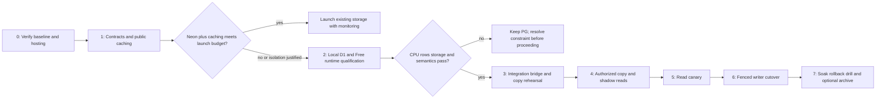

# Down & Distance: implementation roadmap

October 16, 2026. **Planning complete; implementation is not authorized by this audit.** No resource creation, deployment, migration, retention deletion or production setting change is part of this deliverable.

## FO-1 implementation update — local only

The user's later FO-1 request authorizes this implementation and supersedes the planning-only statement above for **FO-1 locally**. Production deployment remains unauthorized. See [the current FO-1 implementation record](FRONT_OFFICE_SCALING_PLAN.md#fo-1-local-implementation--october-16-2026) for architecture, source inventory, exact files, reconciliation API, measurements, rollout and rollback.

Implemented: PostgreSQL-owned complete mutable runtime and shared immutable reference bundles; request-isolated legacy adapters; authenticated owner checks on private routes; versioned commands and atomic gzip response receipts; preserved legacy originals and every submitted recovery artifact; partial/complete/reconciliation statuses; explicit owner confirmation; web/native transports and recovery-required views. New saves are independent IDs. Season rollover retains traded picks and completed drafts and commits contracts/CPU draft changes. Incomplete legacy recovery alone is no longer a stop condition; it blocks that save's gameplay until reconciliation.

Migration **053_front_office_durable_commands.sql** is additive and applied only to localhost, preserving all 21 existing save rows by before/after fingerprint. The proposed editorial 053–055 filenames below must be renumbered; they were never implemented. The former FO-1 056 filename was a placeholder. No production mutation, deployment, existing-save deletion or paid resource activation occurred.

Validation: 13 isolated PostgreSQL integration tests, 96 domain regressions, 13 server API regressions, web/mobile TypeScript and local Next build pass. Chiefs/Seahawks mobile-web recovery/error states were checked in Chromium with screenshots and temporary localhost authentication. Android/iOS device builds and native visual states remain unverified. Representative warm create: 128 ms, 11 SQL statements; 278 KB mutable JSONB text + 2.08 MB shared bundle, versus 1.88 MB expanded runtime. These are local samples, not production capacity guarantees.

Next: FO-2 narrow reads/no-op suppression, FO-3 history separation, production quota/hosting qualification, receipt/evidence growth policy, and native device verification. No archive/retention infrastructure is activated. Rollback must disable admission or use a schema-1-compatible build while preserving committed state/receipts; never reopen migrated saves in the old Map-only implementation.

Read in order: [architecture audit](ARCHITECTURE_AUDIT.md), [cost analysis](FREE_TIER_COST_ANALYSIS.md), [target design](TARGET_ARCHITECTURE.md), [content engine](CONTENT_ENGINE_PLAN.md), [database migration](DATABASE_MIGRATION_PLAN.md).

## Phase 0 — measurements and launch eligibility

Dependencies: production quota recovery; read-only provider access; effective host/Neon/Cloudflare/Google plans. Do not upgrade to obtain audit access. Recover `53000` and identify the actual exhausted meter before export.

Existing files to inspect during implementation baseline: `docs/service-free-tier-audit.md`, `reports/neon-egress-audit.md`, `reports/neon-environment-scheduler-audit.md`, `workers/content-scheduler/{wrangler.toml,src/index.js}`, `.github/workflows/{content-ingestion,three-and-out-daily,search-index,nfl-data-sync,draft-prospect-sync}.yml`, `src/server/{auth/database,search/database}.ts`, `next.config.mjs`, `package.json`.

Proposed new files: `scripts/audit-content-workload.ts`, `reports/content-workload-baseline.md`. The script must default read-only, aggregate-only, refuse unexpected destinations, sanitize errors and never dump credentials/raw user data. Do not add a recurring production profiler.

Database migrations/infrastructure: none. Tests: prove read-only transaction enforcement, bounded query timeout and credential redaction; compare source inventory with enabled live rows and actual execution counts. Avoid running a source-ingestion command as a purported read-only audit.

Acceptance: current plan/host eligibility, same-window Neon compute/transfer/storage, source success/backlog by all 32 teams, provider quota and per-route DB projections measured or explicitly blocked. Commercial $0 hosting resolved or recorded as a release blocker. Exact schema/FK inventory and changed-record/export byte budget available.

Risk: connection can wake Neon; missing production data must not be replaced with local estimates. Rollback: no mutation; stop probes and retain only sanitized aggregate evidence.

## Phase 1 — preserve contracts, measure caching and fairness

Dependencies: phase 0 or a safely isolated local dataset. Default PostgreSQL ownership throughout.

Modify existing files:

- `src/server/story-engine/{repository,projections,service}.ts`, `src/features/story-engine/config.ts`: repository seam, explicit scheduling fairness/throughput and stable ID handling.
- `src/server/content/{canonical-surfaces,content-detail,content-health,refresh-nfl-content}.ts`, `src/features/content/content-engine.ts`: route all public canonical reads through the seam; account for legacy topic-summary/detail behavior without generating from user GETs.
- `src/server/schedule/enrich.ts`, `scripts/sync-nfl-schedule.ts`: explicit enrichment jobs; remove persistence from cacheable GET paths only after equivalence checks.
- `src/app/api/content/{homepage,huddle,wire,next-game}/route.ts`, `src/app/api/content/huddle/[briefingId]/route.ts`, `src/app/api/film-room/route.ts`, `src/app/api/three-and-out/route.ts`, `src/app/api/mobile/stories/[id]/route.ts`, `src/app/content/[id]/page.tsx`: compatibility adapters and public-cache allowlist.
- `src/server/film-room/{discovered,youtube}.ts`, `src/server/cache/public-read-cache.ts`: preserve existing caches and catalog semantics; measure cold misses rather than count every request as cached.

Proposed new files: `src/server/content-store/{types,index,postgres,worker-client}.ts`, `packages/content/{contracts,serialization}.ts`, `src/server/content/public-cache-policy.ts`, `tests/content/{api-contracts,cache-isolation,schedule-enrichment,source-fairness}.test.ts`.

Migration/infrastructure: none for the initial seam. Edge caching requires a separately authorized route/Worker deployment; no assumption that Next cache automatically equals a Cloudflare cache. If fair all-team discovery expands workload, reserve budget before deployment.

Tests: existing story/monitoring/video/Three & Out suites, route JSON snapshots for all existing parameters, malformed/unknown inputs, chronological and importance ordering, source attribution, uncached private responses, correction/Hot Read expiry, full Film Room results and shared-source dedupe. Verify API GETs cannot trigger source fetch/model generation or DB enrichment writes.

Acceptance: identical client-visible contracts; no private cache leakage; fixed all-team source coverage demonstrated; measured Neon+cache scenario passes or fails the cost gates. If it passes and isolation is unnecessary, stop migration work here.

Risk: legacy detail routes and mutable vote overlays can defeat pure caching. Rollback: disable public cache/new read adapter and return to Postgres; keep pre-existing source/delivery semantics available.

## Phase 2 — local D1 engine and Free execution qualification

Dependencies: contract fixtures and ownership map; no production data or paid resources required for initial local work. A deployed Free qualification environment later requires separate rollout authorization.

Proposed new files:

| Area                | Exact proposed paths                                                                                                                                                                             |
| ------------------- | ------------------------------------------------------------------------------------------------------------------------------------------------------------------------------------------------ |
| Worker entry/config | `workers/content-engine/package.json`, `workers/content-engine/wrangler.toml`, `workers/content-engine/tsconfig.json`, `workers/content-engine/README.md`, `workers/content-engine/src/index.ts` |
| Runtime handlers    | `workers/content-engine/src/{http,scheduled,queue,bindings}.ts`                                                                                                                                  |
| Engine              | `workers/content-engine/src/{repository,scheduler,jobs,discovery,publication,projections,integrations,budgets,metrics}.ts`                                                                       |
| Migration           | `workers/content-engine/migrations/0001_editorial.sql` using the proposed schema; no remote execution in local phase                                                                             |
| Tests               | `workers/content-engine/test/{repository,jobs,publication,contracts,budgets}.test.ts`, `workers/content-engine/test/fixtures/`                                                                   |
| Shared pure logic   | `packages/content/{normalization,clustering,material-change,publishing,types}.ts` as needed; keep current logic authoritative until parity proven                                                |

Modify `src/features/story-engine/{normalization,clustering,material-change,publishing-policy,synthesis,types}.ts`, `src/features/three-and-out/{daily,ranking}.ts` and relevant imports only to expose/reuse renderer/platform-independent logic. Fix team-specific fallback templates with all-team tests. Inspect Node `crypto`, `os`, `process.env` and Next cache imports; Worker adapters inject configuration and use supported APIs. Do not import `authDb` into the content Worker.

New infrastructure, after approval: one isolated D1 database, one Worker, one optional Queue. No R2 needed to qualify text/video metadata. Defaults disable cron/bridge/provider calls. Worker migration scripts must explicitly distinguish local/remote and environment destinations.

Tests: proposed SQL constraints, JSON mapping, index plans/metering, duplicate jobs, source revision corrections, expired token leases, version conflict rollback, poisoned messages, unknown team/NFL-wide data, 32-team correctness and full-catalog serialization. Deploy Free benchmark only after local passes; measure actual CPU and queries/subrequests per handler on largest valid inputs.

Acceptance: no lost domain fields, same public JSON, p99 CPU below 8 ms with no observed limit failures on qualification inputs, ≤50 queries/subrequests as applicable, single database projected below 350 MB and quota model including retries/imports below thresholds. Extra queue stages must fit the revised daily operation model.

Risks: CPU limit, D1 substring/query differences and index write amplification. Rollback: feature flags remain Postgres; discard only explicitly disposable local/test resources. Never delete an existing named production resource as cleanup.

## Phase 3 — integration bridge and migration rehearsal

Dependencies: phase 2 qualification; production catalog recovered; schema mapping finalized.

Modify existing files:

- `src/server/story-engine/repository.ts`: isolate notification side effects and durable publication payloads; introduce a writer fence in every write path, including direct admin/CLI mutations.
- `src/server/three-and-out/{daily-service,schema}.ts`: separate published edition reads/generation from recipient lookup/claims; use publication references.
- `src/server/notifications/repository.ts`, `src/server/search/{indexer,answer-data}.ts`: consume versioned content events without old content joins/full corpus rereads.
- `src/features/three-and-out/{editorial-store,poll-store}.ts`, `src/app/api/three-and-out/{editorial,vote}/route.ts`: reconcile durable overrides and private user votes, keep actions/semantics, apply existing admin authorization to editorial writes.
- `src/server/schedule/{repository,ingest,enrich}.ts`: emit public schedule projection changes.
- `src/server/user/{content-repository,content-state,account-repository}.ts`: verify saved IDs, account export/delete and private state stay PostgreSQL-owned; modify only if reference resolution currently assumes old content storage.

Proposed new files: `src/app/api/internal/content-events/route.ts`, `src/server/content-integration/{service,repository,auth,types}.ts`, `scripts/{export-editorial-content,import-editorial-content,verify-editorial-content,replay-editorial-content}.ts`, `tests/content/{bridge-idempotency,migration-roundtrip,rollback,writers-fence}.test.ts`.

Proposed PG migrations: `db/migrations/053_content_integration_bridge.sql`, optional `054_content_delivery_due.sql`, `055_content_writer_fence.sql` (renumber if occupied). New D1 migrations only for qualification-discovered schema changes; preserve a reproducible migration sequence rather than editing an applied 0001.

New infrastructure: authenticated bridge URL/credential and optional Queue bindings in the isolated environment. No public write API or management token in clients. Keep credentials out of logs, reports and source control.

Tests: duplicate/reordered events, network loss after PG commit, source/evidence edits, tombstones, notification audience/consent, existing per-day delivery claims, archived saved links, snapshot counts/hashes/FKs and rollback after new D1 writes. Verify old runs cannot dispatch user notifications during import/replay.

Acceptance: full migration rehearsal produces zero unexplained record/hash/contract mismatches; no user rows copied to D1; no duplicate delivery; fence rejects stale writers; restore/replay recovery proven. Zero actual source deletions.

Risk: cross-store atomicity and delivery FK. Rollback: PG remains authoritative; additive refs/receipts may remain unused. Do not reverse/drop bridge tables containing needed delivery references.

## Phase 4 — authorized copy and shadow validation

Dependencies: separate production rollout authorization, export allowance, backup/replay rehearsal, ownership checklist from database plan. This audit does not supply that authorization.

Modify only migration scripts/flags/config introduced above as discovered by rehearsal. Proposed artifact: `reports/content-migration-manifest.md` with counts/hashes/cursors and no story/user bodies or secrets. Production settings touched later: Worker/D1 bindings, internal bridge secret, disabled scheduler flag, team allowlist; no automatic upgrade.

Migrations: additive bridge/reference backfill and D1 schema only; retain source tables and existing writer. Infrastructure: approved D1/Worker/optional Queue. During initial consistent copy use a short content-write freeze while user APIs continue; reconcile ordered revisions and deletions before shadow comparison.

Tests/acceptance: same counts and normalized hashes for full editorial graph; no orphans; all 32 team API snapshots equivalent; no provider/model/notification side effects from shadows; copy/shadow usage remains within daily/monthly headroom. Initially shadow a small percentage to avoid doubling expensive reads.

Risks: export egress, late writer updates, content mutations in old admin scripts. Rollback: shadow percentage zero; PG stays owner and source tables untouched. If import fails, resume from manifest, not a second full dump.

## Phase 5 — public-read canary and platform validation

Dependencies: shadow correctness and cache controls; no writer switch yet. Enable KC, SEA, then all teams through `CONTENT_TEAMS_ENABLED`; use independent read flag.

Files/config: `src/server/content-store/{index,worker-client}.ts`, `src/server/content/public-cache-policy.ts`, Worker `src/http.ts`, the API adapters listed in phase 1; environment flags documented in `.env.example` during implementation only. Direct edge routing, if desired, is a separate reviewed configuration change after facade parity, not a mobile origin change.

Validation files: `tests/mobile/{beat-pagination,beat-schedule,beat-transactions}.spec.ts` and existing Film Room/native preview tools where appropriate; new `tests/content/public-routing.spec.ts`. Review `apps/mobile/lib/{api,network,types}.ts`, `apps/mobile/app/{beat,film-room}.tsx`, native Three & Out route found at implementation time, and web `src/components/{beat,film-room}` before any shared UI adjustment. API-only migrations should require no renderer redesign.

Migration/infrastructure: no additional database migration. Tests: real mobile-web viewport and real Android/iOS simulator/device navigation, deep links, authentication overlays, saved stories, loading/errors/empty states, forms/modals/drawers where touched, KC and SEA themes and clearance above bottom navigation. RN Web does not count as device validation. For Expo edits read `apps/mobile/AGENTS.md` and exact versioned docs first.

Acceptance: contract and visual behavior maintained, route caching never returns private data, measured cost headroom/freshness meets target for the canary. Report precisely which devices/platforms were checked.

Risk: stale score/Hot Read or detail resolution; different cache regions. Rollback: per-team reads back to PG while PG is still authoritative; invalidate public cache with the tested correction path.

## Phase 6 — single-writer cutover and delivery wakeups

Dependencies: canary passes; a rehearsed reverse replay; separate authorized operational window; enough quota for final delta and rollback.

Files/config: `workers/content-engine/src/{scheduled,jobs,publication,integrations}.ts`, `workers/content-scheduler/{src/index.js,wrangler.toml}`, `.github/workflows/{content-ingestion,three-and-out-daily,search-index}.yml`, `src/app/api/automation/content/global/route.ts`, `src/app/api/automation/three-and-out/route.ts`, `src/server/content/refresh-nfl-content.ts`, `scripts/run-content-ingestion.ts`, `scripts/backfill-film-room.ts`.

Operational consumers to redirect or fence: `scripts/backfill-{team-content,beat-semantics,beat-transactions}.ts`, `scripts/verify-beat-semantic-backfill.ts`, `scripts/capture-beat-semantic-baseline.ts`, `scripts/{resolve-youtube-sources,video-source-health,sync-production-content-to-local,content-ollama-stress-test}.ts`, `src/scripts/sync-team-content.ts`. Verify the complete direct-SQL caller inventory again before cutover; local/maintenance commands must not continue silently writing the retired owner.

Migrations: validate publication-reference FK and switch delivery code before removing old FK; apply optional next-due schedule migration only after timing tests. Existing canonical-story `game_id` FK remains in retained PG copy; new D1 owner uses a logical ID and schedule projection.

Operational order: pause/fence old scheduler and all admin/CLI writers; drain or checkpoint in-flight jobs; final delta/hash verification; increment ownership epoch; enable D1 writer; enable durable outbox consumer; then enable exactly one discovery scheduler. Keep manual APIs as authenticated proxies to the selected owner. No interval with two independently active writers. Retain old configuration for recovery without restarting it prematurely.

Delivery: retain existing five-minute behavior until the next-due control signal is proven, then replace idle DB polling without changing per-user IANA timing. One minute Worker ticks read an independent small signal, not PostgreSQL on every tick. Preference commits and durable reconciliation update the signal; periodic reconciliation must be budgeted. If this is not implemented, do not certify Neon scale-to-zero or $0 compute.

Tests/acceptance: a day of all-team rounds, forced duplicate schedules, stale-epoch rejection, expected source coverage, edition generation/delivery at DST/midnight boundaries, search/notification lag and SQL limits; observe current provider metrics. No duplicate events or lost user preferences. Keep observer-mode/consent behavior intact.

Risk: partial cutover, external push ambiguity and retained old deployments writing. Rollback: stop D1 writes, fence epoch, replay all post-cutover content changes/tombstones/receipts into PG, verify parity and only then switch reads/writes/scheduler back. A read flag flip alone is not valid once PG is stale.

## Phase 7 — soak, recovery and optional retention

Dependencies: at least 14 days of stable operation including a busy game day and a successful rollback rehearsal. Retention is a separate decision; this plan never authorizes deletion of production content or user data.

Potential future files: `workers/content-engine/src/archive.ts`, `scripts/archive-editorial-content.ts`, `workers/content-engine/migrations/0002_archive_metadata.sql` only if needed, and updates to content repository retrieval adapters. R2 binding may be added only after rights, billing controls and quotas are verified. Keep backups/checksums and retrieval tests before moving cold raw bodies.

Tests: restored D1 state plus PostgreSQL receipts, no repeated user notifications after restore, archived article/search evidence retrieval, saved links, queue expiry recovery, cache takedown and budget exhaustion. Keep worst-case expiry/retry input replay fixtures.

Acceptance: measured month projection below cost thresholds, enough storage headroom for 90 days, all public/user contracts maintained and a documented operator recovery procedure. Never prune just to make a cost chart look free. Rollback: archive pointer reversal and source restore under fencing; preserve user-owned state and historical receipts.

## Completion and stop rules

The present task stops at these six planning documents. Implementation order is 0 → 1 → conditional 2 → 3 → 4 → 5 → 6 → 7. Each failed gate stops dependent rollout; a paid upgrade, removed feature, contract change or destructive retention action requires a new explicit decision. Account/free-tier status must be rechecked immediately before any future production action.

Current validation: repository/read-only aggregate inspection and document checks only. No application tests, web/native builds, device visual validation, migration rehearsal, provider resource creation or production deployment was performed in this audit.

## Separate workstream — Front Office scalability and data lifecycle

Added October 16, 2026. The earlier completion/stop statement applies to the editorial audit. This independently requested **planning-only** workstream is detailed in [FRONT_OFFICE_SCALING_PLAN.md](FRONT_OFFICE_SCALING_PLAN.md); it does not authorize implementation or change the editorial migration sequence, D1 ownership boundaries, proposed migrations 053–055 or production settings.

Front Office remains PostgreSQL-owned. Editorial D1/Workers/cache infrastructure is still proposed, not assumed deployed. Gameplay correctness and ownership fixes precede cost optimization: the current simulation is durable, but full roster/cap/pick/market state also depends on process/client stores, and legacy save routes do not consistently validate ownership before runtime access. Do not cache or archive that split as if it were a complete authoritative save.

| Phase                                               | Planned scope and files                                                                                                                                                                                                                                                                                                                                                                        | Gate / rollback                                                                                                                                                                                                                                        |
| --------------------------------------------------- | ---------------------------------------------------------------------------------------------------------------------------------------------------------------------------------------------------------------------------------------------------------------------------------------------------------------------------------------------------------------------------------------------- | ------------------------------------------------------------------------------------------------------------------------------------------------------------------------------------------------------------------------------------------------------ |
| FO-0: Baseline                                      | Read-only local save/event/offer metrics; route ownership and write/read trace inventory. Proposed `scripts/audit-front-office-storage.ts` and `tests/front-office/ownership-matrix.test.ts`. No repeat production probes while quota remains blocked.                                                                                                                                         | Verify real production schema later; preserve source data. No mutations to undo.                                                                                                                                                                       |
| FO-1: Durable owned commands                        | `src/server/front-office/{repository,commands,state-repository,ownership,serialization,draft-lifecycle,refresh-hero,trade-window}.ts`, `src/server/api/{store,save,players,draft,trades}.ts`, affected gameplay/save/action routes; proposed `packages/front-office/{save-schema,save-command}.ts`. Add complete roster/cap/pick/market state, command IDs and client expected-version checks. | Every action survives restart/cross-device recovery; failed CAS/auth cannot mutate shared memory. Additive migration placeholder 056, renumber at implementation. Roll back admission through compatible checkpoints, never a legacy incomplete state. |
| FO-2: Smaller reads and private caching             | Owned metadata/version selectors, pure GETs, projected bootstrap/news counts, request coalescing, bounded private cache; `src/server/front-office/{views,private-cache,events-repository}.ts`, state/simulation/news/header APIs, web save store/panels and native franchise components.                                                                                                       | No public CDN save cache; measure SQL/bytes per session. Rollback read adapter/cache while retaining ownership checks and authoritative data.                                                                                                          |
| FO-3: Shared reference versions and season archives | `src/lib/franchise-simulation.ts`, `src/types/{front-office,draft,franchise}.ts`, proposed archive/reference modules and owned history APIs; migration placeholder 057. Stop embedding full prior seasons in every hot save.                                                                                                                                                                   | Preserve every implemented result/stat/draft/transaction and pinned historical identity; old/new client adapters pass. Restore from retained old payload/manifests, never re-simulate history.                                                         |
| FO-4: Codec and retention qualification             | Proposed `scripts/benchmark-front-office-codecs.ts`, `src/server/front-office/archive-codec.ts`, integrity metadata placeholder 058. Local structural/gzip tests suggest savings but do not measure net TOAST/WAL savings.                                                                                                                                                                     | Round-trip equality, real PG storage/CPU/restore benchmarks, no destructive cleanup. Original source bytes retained for rollback.                                                                                                                      |
| FO-5: Optional private object archive/export/delete | Proposed archive-storage/lifecycle modules, optional qualified Worker orchestrator, archive-job migration placeholder 059, account export/delete coverage. R2 is optional; PG-only archives remain a functioning launch design.                                                                                                                                                                | Separate resource/destructive-cleanup approval, private ownership checks, verified object before source removal, restore/export/purge tests. No automatic deletion due to inactivity.                                                                  |
| FO-6: Cohort rollout                                | Seven-day resource measurements and busy/power multi-season replay; independent Front Office flags and per-owner canary.                                                                                                                                                                                                                                                                       | Forecast total application Neon/storage/hosting budgets, prove rollback before widening cohort; no paid upgrade fallback.                                                                                                                              |

The plan includes measured local sizes/compression, a ten-season isolated simulator experiment, complete lifecycle/recovery policy, tests and 100/1,000/5,000/10,000/25,000-user models for light/average/power behaviors. Its scattered-session forecast yields roughly 175 light, 40 average or eight power users within an allocated Front Office Free compute budget; these are conditional scenario thresholds, not production capacity certification. Production quota, delivery polling elsewhere in the application and commercial hosting eligibility remain shared release gates.

Retain meaningful progress and all existing franchises. No inactivity-based deletion, paid cache/service, schema application, application code change or infrastructure deployment is part of this planning task. Before future shared UI changes follow web/native parity instructions; native validation requires actual Android/iOS devices or simulators.
