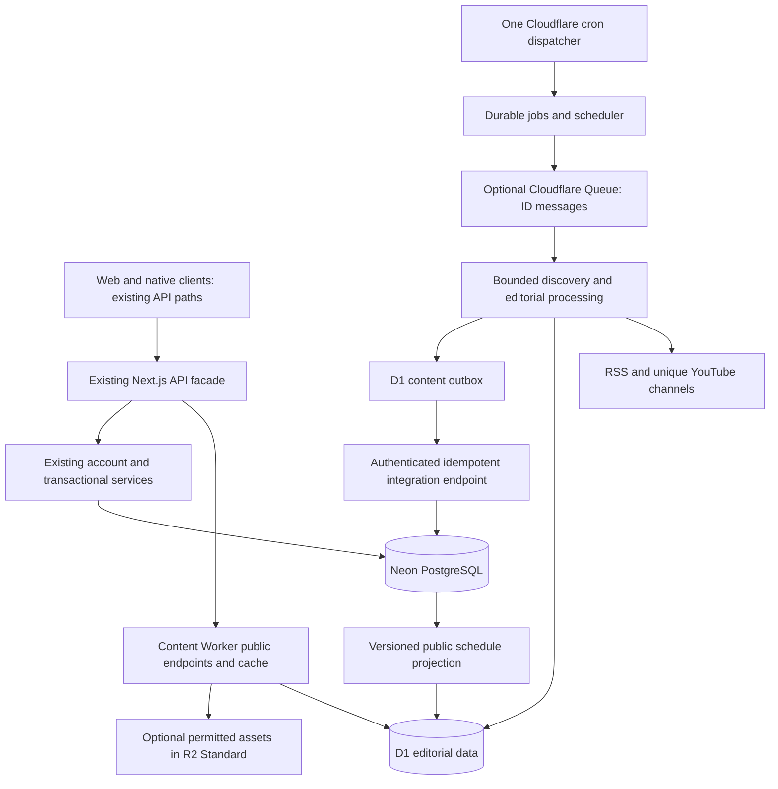

# Down & Distance: target architecture

October 16, 2026. Proposal only; no resources provisioned. Read with [audit](ARCHITECTURE_AUDIT.md), [cost gates](FREE_TIER_COST_ANALYSIS.md) and [migration plan](DATABASE_MIGRATION_PLAN.md).

## Recommendation and decision gates

Adopt **one shared D1 editorial database**, one small content Worker with scheduled/HTTP/optional queue handlers, existing PostgreSQL transactional services, and public response caching. Avoid per-team databases, a second identity system, a general event bus, paid AI, Hyperdrive, Durable Objects and a frontend rewrite as prerequisites. D1 is justified only if measured public-content isolation reduces Neon transfer/compute and all execution/storage limits pass.

Do public caching and scheduling measurement first. If Neon plus caching meets the launch envelope, stop there until evidence justifies the migration. If D1 qualification fails CPU, query semantics or storage tests, keep PostgreSQL as content owner; do not quietly upgrade Cloudflare. A full commercial $0 hosting solution remains a separate launch gate: current Next hosting cannot simply be assumed eligible/free, and native Argon2/Node dependencies prevent assuming the whole app drops into Workers unchanged.

This diagram shows the initial API facade. Later routing public paths directly to the Worker can avoid Next function calls, but only after testing origin routing, unknown paths, cookies, CORS, caching and deployment ownership. Do not change mobile origins to an unversioned Worker endpoint. Auth/account/trivia/simulation routes continue to their existing service.

## Ownership boundaries

| Owner                 | Owns                                                                                                                                                                                                                                                       | Does not own                                                                                       |
| --------------------- | ---------------------------------------------------------------------------------------------------------------------------------------------------------------------------------------------------------------------------------------------------------- | -------------------------------------------------------------------------------------------------- |
| D1 content engine     | Source definitions/health/checkpoints, candidates and associations, stories/evidence/versions/publishing decisions, overrides, editorial card descriptors, video metadata, published Three & Out editions, jobs, content run summaries, integration outbox | Sessions, preferences, push tokens, recipients, private media, gameplay, betting state or payments |
| PostgreSQL            | Auth, all user state, Front Office saves/events, Parlay odds/history/transfers, authoritative schedule/stats, trivia/rewards, social/commerce, notification/delivery claims, derived existing search index                                                 | Long-term canonical editorial authority after cutover                                              |
| R2 Standard, optional | Owned/licensed images and permitted media; checksummed content archives/backups only if enabled within budget                                                                                                                                              | YouTube video copies, unlicensed publisher photos, private crew uploads made public                |
| Cloudflare cache      | Replaceable public JSON and immutable assets                                                                                                                                                                                                               | Canonical state, queues, authorization, consent or user responses                                  |

Preserve existing story/candidate/source/edition/game IDs exactly. Keep NFL-wide nullable/global team semantics. Physical D1 foreign keys remain within that database. PostgreSQL content references become validated logical references or a minimal `content_publication_refs` anchor for delivery integrity. Public schedule snapshots are derived; they never update sportsbook or simulation truth.

## Content API compatibility

Introduce a server-only `ContentRepository` interface with Postgres and Worker HTTP implementations. Next cannot use a Cloudflare D1 binding directly in its existing runtime; use a narrow authenticated internal HTTP API for private content operations, and a separate cacheable public API. Do not put Cloudflare management API credentials in web or native clients.

Keep legacy endpoint paths, response fields, casing, timestamps, IDs, status codes, pagination clamping, sorting/tie-breaking, query filters and game/graphic metadata. Snapshot tests must compare representative old/new JSON for each route, including unknown team, missing edition (503), missing detail (404), API failure (500) and legitimate empty results. Do not return fabricated articles on failure.

Film Room continues to return the complete catalog required by the existing contract, with curated/discovered deduplication, categories, unavailable IDs and message semantics. Persist metadata refreshes in the engine; public reads should not call Google. A later paginated v2 route is optional and must update both renderers before replacing the existing response. Large catalogs require a measured serialization/response-size test, not truncation.

The `configured` field must retain its meaning when provider configuration moves to Workers: expose a safe service capability, not whether Next still holds a key. Preserve `/api/mobile/stories/[id]`, `/api/content/huddle/[briefingId]` and browser detail pages as explicit adapters.

Three & Out has a public edition payload plus a mutable poll overlay. Cache only the public edition. Keep user votes/preferences and personalized overlays private; do not cache the whole response until its aggregate vote semantics are separated and tested. Reconcile in-memory legacy overrides with durable SQL/D1 overrides and protect editorial writes through existing admin authorization before exposing them on the Worker. An editor ID in request JSON is not authentication.

## Caching and enrichment

Use 60-second public JSON TTL at launch; Film Room metadata refresh remains a background concern. Keys include API schema version, team, edition/date/page, all filter/range/sort/search parameters, locale where relevant and response representation. Canonicalize equivalent keys, validate parameters and bound cache cardinality. Arbitrary search queries use rate-limited uncached or short-lived execution; unknown query values cannot multiply caches indefinitely.

Only an allowlist of anonymous, public GET responses enters shared cache. Strip client cookies/authorization only when calling a public endpoint that ignores them by contract; bypass caching for every authenticated overlay, admin call, mutation, `Set-Cookie`, failed response and private path. Never use authenticated HTML as the public cache object. Worker invocations still count when `caches.default` returns a hit.

Cloudflare Cache API entries are local to a data center; local deletion is not global invalidation. Therefore use bounded TTL as the baseline, content-versioned immutable asset URLs, and test a dedicated takedown/global purge path before launch. Do not promise immediate global correction from `cache.delete()`. Cache eviction may happen at any time. [Cloudflare Cache API](https://developers.cloudflare.com/workers/runtime-apis/cache/).

Move `enrichGameStories` persistence out of GETs. Update a small schedule projection from the existing schedule importer on material game changes, compute game resolution/transaction graphic descriptors at publication, and refresh affected public views after schedule updates. Cache freshness for scores and Hot Read expiration must obey the shorter of TTL and next relevant expiration. Never freeze a live game's metadata indefinitely.

## Transactions and cross-store reliability

D1 uses prepared SQLite statements and atomic batches; the current PostgreSQL callback transactions and `FOR UPDATE SKIP LOCKED` cannot be copied literally. A batch must include story/version/evidence/decision/outbox/projection writes under a version or lease-token guard. A zero-row compare-and-swap must not leave dependent inserts committed: use guarded `INSERT ... SELECT` statements and a tested abort constraint/trigger, or another proven all-or-nothing design. No network calls inside a publication commit. [D1 batch API](https://developers.cloudflare.com/d1/worker-api/d1-database/).

Write outbox events in that same batch. Bridge requests carry event ID, story/edition version, team, safe notification content and dedupe key. PostgreSQL validates the service credential and audience, creates publication references and user notifications/search changes in a local transaction, and deduplicates by event ID. Lost HTTP responses may retry; acknowledge the D1 event only after the PostgreSQL transaction commits. Reordering cannot regress versions. Users/tokens/consent never enter D1 or Queue messages.

Keep recipient timing and claims in PostgreSQL, with IANA timezones and existing per-user/day/channel uniqueness. Replace constant DB polling later with an indexed PostgreSQL `next_due_at` schedule and a small control-plane next-wakeup signal exposed to the Worker. Preference changes update that signal after commit, with a durable PostgreSQL outbox and reconciliation. A Worker tick reads the signal and wakes PostgreSQL only when due; it must not query Neon every tick to decide whether to query Neon. Omit recipient PII from that signal. If this mechanism is deferred, retain five-minute delivery behavior and explicitly accept the compute risk; content migration alone does not solve it.

Search retains current lexical/vector behavior through changed-document/tombstone outbox events. Index full unchanged corpora neither on each content run nor on every public request. Evidence edits, relinks, source renames and deletions must change document fingerprints. Reconciliation remains bounded and resumable; if full-source text is needed for the current search contract, include only changed authorized text, not every historical article on each pass.

## Operations and safety controls

One scheduler owns source discovery. D1 jobs are durable truth; Queues is optional transport. Small messages contain job ID/type/lease generation, not article bodies or credentials. Recover expired leases and unsent outbox entries even if Queue delivery expires. Fair per-team budgets prevent KC/high-priority sources monopolizing processing.

Feature flags proposed: `CONTENT_READ_BACKEND=postgres|worker`, `CONTENT_WRITE_OWNER=postgres|d1`, `CONTENT_WORKER_ENABLED=false`, `CONTENT_QUEUE_ENABLED=false`, `CONTENT_SHADOW_READ_PERCENT=0`, `CONTENT_TEAMS_ENABLED`, `CONTENT_R2_ENABLED=false`, `CONTENT_PAID_AI_ENABLED=false`. Defaults preserve current behavior; unknown values fail closed. Writer ownership is a durable, fenced migration epoch, not merely an environment flag. Reads and ownership rollback have different procedures.

Monitor provider meters and D1 returned row metrics, not just SQL result count. Track cache misses by region, CPU by handler/job type, source freshness per team, backlog age, lease recovery, dedupe, generation decisions, outbox lag, API errors and estimated bytes. Redact raw article bodies, auth headers and URLs carrying keys. Use aggregate run summaries and bounded debug sampling; no paid logging exporter. Cost thresholds and failure behavior are in [FREE_TIER_COST_ANALYSIS.md](FREE_TIER_COST_ANALYSIS.md).

Runtime acceptance requires real deployed Free-plan measurements after separate implementation approval. No Android/iOS validation, production canary or load benchmark was performed during this audit.
